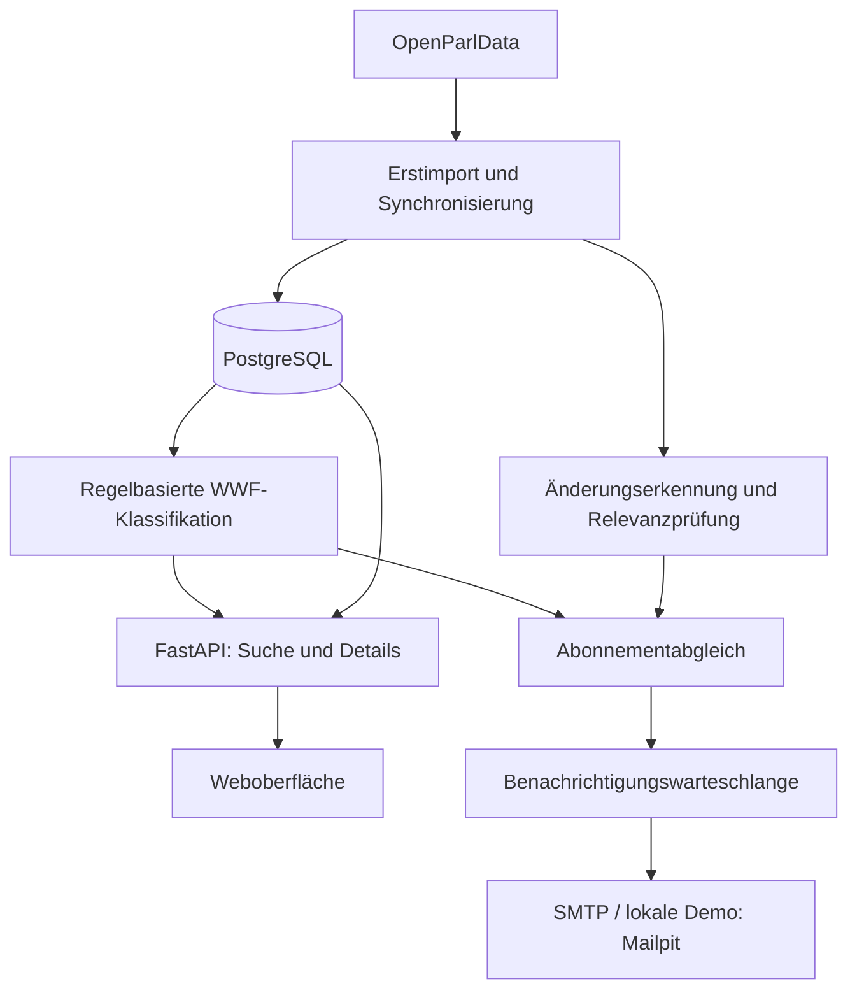

# WWF Polit-Assistant

**Parlamentarische Entwicklungen finden, einordnen und verfolgen.**

Der WWF Polit-Assistant bündelt Schweizer Parlamentsdaten aus OpenParlData und macht sie nach WWF-Themen, Kantonen, Datum und Suchbegriffen zugänglich. Zusammengehörige Geschäfte, Sitzungen, Traktanden und Dokumente lassen sich im politischen Kontext betrachten. Abonnements informieren per E-Mail über relevante neue Inhalte und Änderungen.

Das Projekt entsteht für **WWF Schweiz** im **Wirtschaftsprojekt (WIPRO)** des BSc Informatik an der **Hochschule Luzern (HSLU)**. Der aktuelle Stand ist ein funktionsfähiger Entwicklungs-MVP; die fachliche Abnahme und der Betrieb in der WWF-Umgebung stehen noch aus.

[Projektziele](#projektziele) · [Funktionen](#funktionen) · [Demo starten](#quick-start-mit-docker) · [Architektur](#architektur) · [Entwicklung](#lokale-entwicklung) · [Dokumentation](#dokumentation)

## Projektziele

Das MVP soll die politische Recherche und das Monitoring für WWF vereinfachen:

- **Relevante Inhalte finden:** parlamentarische Daten nach Themen, Kantonen und individuellen Suchbegriffen durchsuchen.
- **Zusammenhänge verstehen:** zu einem Geschäft auch die zugehörigen Termine, Ereignisse, Abstimmungen und Dokumente sehen.
- **Entwicklungen verfolgen:** Themen abonnieren oder einzelne Einträge beobachten und über relevante Veränderungen informiert werden.
- **Eine anschlussfähige Grundlage schaffen:** dokumentierte API, strukturierte Daten und eine containerisierte Python-Anwendung für die spätere Integration in die WWF-Systemlandschaft.

Die Themenklassifikation erfolgt regelbasiert. KI, semantische Suche und dialogorientierte Abfragen sind mögliche Erweiterungen; sie sind im aktuellen MVP nicht umgesetzt.

## Funktionen

### Recherche in neun Bereichen

Jeder Bereich besitzt eine eigene Liste und eigene Filter. Beim Wechsel bleiben die jeweiligen Filter erhalten. Ein Klick auf einen Eintrag öffnet seine Details und die verfügbaren Verbindungen zu anderen Datensätzen.

Der Änderungsverlauf eines Geschäfts zeigt die Titel der betroffenen Inhalte und öffnet vorhandene Einträge direkt. Mehrfache Zuordnungen desselben Quelldokuments werden zusammengefasst; unterschiedliche Dokumente und inhaltliche Aktualisierungen bleiben getrennt sichtbar. Die Schliessen-Schaltfläche langer Detailansichten bleibt beim Scrollen erreichbar.

| Bereich | Inhalt und Zusammenhang |
|---|---|
| **Geschäfte** (`affairs`) | Parlamentarische Vorstösse und Geschäfte mit Status, Klassifikation und zugehörigen Vorgängen |
| **Traktanden** (`agendas`) | Tagesordnungspunkte mit Verbindung zur Sitzung und gegebenenfalls zum Geschäft |
| **Sitzungen** (`meetings`) | Parlamentarische Termine, Sitzungsinformationen und zugehörige Traktanden |
| **Abstimmungen** (`votings`) | Abstimmungsfragen und aggregierte Ergebnisse mit verfügbaren Geschäfts- und Sitzungsbezügen |
| **Ereignisse** (`events`) | Schritte im parlamentarischen Verlauf, etwa Einreichung oder Behandlung eines Geschäfts |
| **Dokumente** (`documents`) | Publizierte Unterlagen, Quellenlinks und vorhandener extrahierter Inhalt |
| **Texte** (`texts`) | Parlamentarische Textinhalte mit Bezug zum jeweiligen Geschäft |
| **Gruppen** (`groups`) | Parlamentarische Gremien und Gruppen sowie verfügbare zugehörige Sitzungen |
| **Interessenbindungen** (`interests`) | Deklarierte Interessen mit Informationen zur zugehörigen Person |

Die Suche kombiniert **Suchbegriff, Hauptthema, Unterthema, Kanton und Datumsbereich**. Ergebnisse werden serverseitig paginiert. Die Oberfläche unterstützt **Deutsch, Französisch, Italienisch und Englisch**; parlamentarische Originaltexte werden nicht automatisch übersetzt.

Themenetiketten zeigen **Hauptthema / Unterthema**, beispielsweise **Klima & Energie / Sonstiges**. Dieses lokale Sonstiges bezeichnet einen passenden Hauptbereich ohne spezifisches Unterthema; das globale Sonstiges bezeichnet Inhalte ohne erkannte WWF-Zuordnung.

In der Bereichs- und bereichsübergreifenden Suche werden Geschäfte mit gleichem normalisiertem Titel, gleicher Körperschaft und gleichem Kalendertag als eine Ergebniskarte zusammengefasst. Beispielsweise bleiben Regierungsbotschaft und Gesetzesentwurf über getrennte Schaltflächen erreichbar. Die Originaldatensätze, IDs und Detailansichten bleiben erhalten; Trefferzahl und Pagination zählen die Gruppen. Das ist eine Darstellungsregel und keine nachgewiesene fachliche Identität der Quellen. Andere Tage oder Körperschaften bleiben getrennt.

### Konfigurierbare WWF-Themen

Die vier Hauptbereiche **Klima & Energie**, **Biodiversität & Landschaft**, **Nachhaltige Wirtschaft & Konsum** und **Umwelt & Politik** besitzen jeweils eine Sonstiges-Unterkategorie. Namen, Hierarchie, Synonyme, Regeln und Schwellenwerte werden in [taxonomy.json](app/classification/taxonomy.json) gepflegt. Die Oberfläche übernimmt die konfigurierten Namen aus der Kategorien-API.

Die aktuelle Version `rule-based-v7` erkennt eindeutige Titelbegriffe auch in Zusammensetzungen und mit Buchstaben-Endungen. Generische Begriffe benötigen einen ausdrücklichen Umweltbezug. Mehrere Themen können gleichzeitig passen; spezifische Unterthemen verdrängen den lokalen Fallback ihres Hauptthemas. Übersetzungen und Synonyme zählen als ein Konzept. Details und Befehle: [Klassifikationskonzept](docs/04-technical-concepts/classification-concept.md) und [Konfiguration](docs/configuration.md#regelbasierte-klassifikation).

### Abonnements und E-Mail-Monitoring

Die Recherche ist ohne Konto zugänglich. Für Benachrichtigungen registrieren sich Nutzer per E-Mail und melden sich über einen zeitlich begrenzten Link an. Optional steht eine konfigurierte Google-Anmeldung zur Verfügung. In der Abonnementverwaltung können bis zu zehn Benachrichtigungsadressen ausgewählt werden; zusätzliche Adressen benötigen eine Bestätigung.

Abonnements können WWF-Themen, Kantone, Suchbegriffe und Datenbereiche kombinieren. Zusätzlich lassen sich einzelne Einträge verfolgen. Hauptthemen schliessen ihre Unterthemen ein. Mehrere Werte innerhalb einer Filtergruppe gelten als Alternativen; Einschränkungen verschiedener Gruppen müssen gemeinsam passen.

Die Anwendung speichert Quelldatenänderungen getrennt von ihrer Benachrichtigungsrelevanz. Technische Metadaten, reine Formatänderungen und bestimmte geringfügige Textkorrekturen sollen keine E-Mail auslösen. Relevante Updates werden pro Nutzer und Geschäft beziehungsweise eigenständigem Eintrag zusammengefasst.

Benachrichtigungen besitzen eine HTML-Ansicht mit Inhaltskarten und eine separate Klartextfassung. Der Betreff benennt beispielsweise ein neues Dokument; Dokumentlinks, Geschäftsverlauf und Abonnementverwaltung sind eindeutig beschriftet. Bereits zugestellte E-Mails werden nicht verändert oder automatisch erneut versandt. Eine Aktualisierung ohne passende neue Entwicklung erzeugt keine neue Nachricht.

## Aktueller Projektstand – 13. Oktober 2026

**Stand: 13. Oktober 2026.** Datenimport, neun Synchronisationsmodule, konfigurierbare regelbasierte Klassifikation, Recherche, verknüpfte Detailansichten, passwortlose Anmeldung und Abonnementverwaltung sind implementiert. Die Benachrichtigungspipeline berücksichtigt auch Änderungen an verbundenen Datensätzen. Ollama ist nicht eingebunden; LLM und Chatbot bleiben mögliche spätere Erweiterungen.

91 isolierte Backend-Regressionstests sowie JavaScript-Prüfungen wurden erfolgreich ausgeführt. Die Browser-, Docker-Demo-, Mailpit- und Neustartprüfungen stammen vom 12. Oktober und wurden für die jüngsten Änderungen nicht vollständig wiederholt. Das ersetzt keine vollständige fachliche Abnahme oder Prüfung unter Produktionsbedingungen.

Am 13. Oktober wurden **2.951.254 vorhandene Datensätze in allen neun Bereichen** mit `rule-based-v7` neu klassifiziert. Eine unabhängige schreibgeschützte Abfrage bestätigte **0 fehlende und 0 veraltete Zuordnungen**. Der Backfill änderte keine Quelldaten und erzeugte keine Benachrichtigungen. Dies ist ein technischer Abdeckungsnachweis, keine Aussage über die Richtigkeit aller Kategorien.

Ein gemischtes Entwicklungsset mit 50 realen Beispielen erreichte **40/50 mit den vorherigen Regeln und 50/50 mit den neuen Regeln**: 20 eindeutige WWF-Themen, 20 fachfremde und 10 unklare oder mehrthematische Beispiele. Die Erwartungen wurden anhand der Quellen unabhängig festgelegt; eine WWF-Expertenabnahme und ein unabhängiges, ungesehenes Prüfset stehen aus. Nachweise: [Prüfung vom 13. Oktober](docs/05-testing/review-2026-10-13.md), [Qualitätsbericht](rule_quality_report_tr.md) und [Backfill-Abdeckung](rule_backfill_status.json).

Am 12. Oktober verarbeitete ein vollständiger Synchronisationslauf **1.682.302 Einträge** und schloss **9/9 Datasets ohne Fehler** ab. Anschliessend wurde auch der damals zuletzt vom Nutzer gestartete Lauf mit 9/9 erfolgreich beendet. Die Quellstichproben vom 12. Oktober umfassten 500 Inhalte je Dataset und zeigten keine fehlenden oder abweichenden Einträge. Diese Befunde gelten für die geprüften Läufe und die Stichprobe; sie sind kein vollständiger historischer Abdeckungsnachweis. Der Klassifikations-Backfill vom 13. Oktober war kein erneuter Quellenabgleich.

Die technische MVP-Umsetzung ist für eine gemeinsame Demonstration vorbereitet. Präsentation, fachliche Bewertung und formale Projektabnahme stehen noch aus. Azure-Bereitstellung und KI/Dialogfunktionen sind keine offenen Implementierungsaufgaben dieses MVP.

### Abgeschlossene Arbeiten und Korrekturen

| Bereich | Umgesetzter und geprüfter Stand |
|---|---|
| Recherche und Oberfläche | Neun Bereiche mit eigenen Filtern; breitere Ergebnisfläche; ausgewogene Kontoschaltflächen; überflüssige Anmelde-Erfolgsmeldung und schwebende Konto-Leiste entfernt |
| Themen und Ergebnisgruppen | Konfigurierbarer Themenbaum mit vier lokalen Fallbacks; Haupt-/Unterthema sichtbar; gleichnamige Geschäftsquellen desselben Tages und derselben Körperschaft in einer Karte mit getrennten Detailzugängen |
| Regelqualität und Backfill | Titelzusammensetzungen, Umwelt-Kontextprüfung und robuste Textnormalisierung; 50-Beispiele-Entwicklungstest; resumierbarer Backfill über alle neun Bereiche mit Qualitätsschranke und Sync-Sperre |
| Detailansichten | Schliessen bleibt beim Scrollen sichtbar; Verfolgen wird ausschliesslich in der Abonnementverwaltung angeboten; Änderungen zeigen benannte, anklickbare Inhalte statt gleichlautender Zeilen |
| Konten und Abonnements | Getrennte Registrierung/Anmeldung mit passenden Hinweisen, optionale Google-Anmeldung, bis zu zehn bestätigte Empfänger; erreichbare Verwaltungsaktionen, Speicherbestätigung und Kontolöschung |
| Datenabgleich | Einheitliches Event-Mapping, Nachholung fehlender Dokumente und Behandlung mehrfacher Dokumentzuordnungen; Batch-Fortschritt, Wiederaufnahme und Schutz vor parallelen Jobs |
| Windows-Checkpoints | Atomisches Schreiben mit eigenen temporären Dateien und begrenzten Wiederholungen bei vorübergehenden Dateisperren |
| Benachrichtigungen | Relevanzprüfung statt Nachricht bei jeder technischen Änderung; Gruppierung pro Nutzer/Geschäft; HTML und Klartext, korrekte Sonderzeichen und eindeutig beschriftete Links |
| Fehlerbehandlung | E-Mail-Fehler ergeben einen erfolglosen CLI-Abschluss; Dataset-Fortschritt bleibt erhalten, ausstehende Nachrichten können erneut verarbeitet werden |
| Scheduler und Schema | Scheduler-Konfiguration mit persistenten Logs und STARTTLS; Datenbank auf `20261012_recipients (head)`. Beim letzten Prozesscheck am 13. Oktober lief nur PostgreSQL; API/Scheduler müssen separat gestartet werden |
| Dokumentation und Tracking | Sieben Dokumentationsbereiche, Installations-/Betriebs-/Benutzerhandbuch, Anforderungen, Tests und Übergabeunterlagen; GitHub-Issues und Milestones angelegt |

### Nachweise und Grenzen

| Kontrolle vom 12. Oktober | Ergebnis |
|---|---|
| Backend unter Windows | 81 Tests erfolgreich |
| Backend im aktuellen Linux-Image | 81 Tests ausgeführt: 80 erfolgreich, eine Windows-spezifische Prüfung übersprungen |
| Frontend und Browser | JavaScript-Prüfungen sowie Desktop-/Mobile-Szenarien erfolgreich; verlinkter Geschäftsverlauf geprüft |
| Docker-Demo / Mailpit | Registrierung, Bestätigung, Anmeldung, Empfängerverifikation, Abonnements, Logout und Kontolöschung geprüft |
| Neuer vollständiger Sync | 9/9 Datasets, 1.682.302 unveränderte verarbeitete Einträge, keine Dataset- oder Versandfehler |
| Letzter manueller Nutzerlauf | Ebenfalls 9/9 ohne Fehler; keine weiteren neuen oder geänderten Inhalte |
| Erneuter direkter Quellenvergleich | 500 Datensätze je Bereich, insgesamt 4.500: keine fehlenden Einträge, Inhaltsabweichungen oder Mappingfehler |

Bei der vorherigen Reparatur wurden **1.158 Dokumente nachgetragen und 32 geändert**. Die späteren Läufe mit `NEW=0` und `CHANGED=0` bedeuten deshalb nicht, dass heute überhaupt nichts aktualisiert wurde. Nachgetragene historische Quelldaten sind ausserdem keine automatisch am heutigen Tag neu publizierten politischen Inhalte.

Weitere Nachweise: [Gesamtprüfung](docs/05-testing/review-2026-10-12.md), [Testergebnisse](docs/05-testing/test-results.md) und [aktueller Aufgabenstand](docs/01-project-management/current-status.md). Automatisierte Tests und Quellenstichproben ersetzen keine WWF-Abnahme und keinen vollständigen historischen Inhaltsvergleich.

## Quick Start mit Docker

Für die lokale Demo werden **Docker Desktop** (gestartet) und **Git** benötigt. Alternativ kann das Repository als ZIP heruntergeladen werden. Eine separate Installation von Python oder PostgreSQL und eine eigene `.env` sind nicht erforderlich.

### 1. Repository herunterladen

```sh
git clone https://github.com/FatihHayyar/wwf-polit-assistant.git
cd wwf-polit-assistant
```

Bei einem ZIP-Download das Archiv entpacken und ein Terminal im Projektordner öffnen.

### 2. Anwendung starten

```sh
docker compose -f docker-compose.demo.yml up --build -d
```

Docker startet **FastAPI**, **PostgreSQL 17**, die **Alembic-Migrationen** und **Mailpit**. Der erste Start benötigt Internet für Images und Python-Pakete und kann einige Minuten dauern.

Eine leere Demo-Datenbank erhält automatisch **500 Beispieldatensätze pro Bereich** mit vorhandenen WWF-Klassifikationen. Zusätzliche verknüpfte Referenzdaten erhalten den Kontext der Detailansichten; deshalb enthalten einige Bereiche mehr als 500 Einträge. Die Stichprobe liegt bereits im Repository, ein vollständiger OpenParlData-Import ist nicht erforderlich.

Die Demo verwendet eine eigene Datenbank, erhält vorhandene Daten beim Neustart und startet keine tägliche Synchronisierung.

### 3. Anwendung öffnen

| Dienst | Adresse |
|---|---|
| Polit-Assistant | [localhost:8081](http://localhost:8081) |
| Swagger / OpenAPI | [localhost:8081/docs](http://localhost:8081/docs) |
| Lokale E-Mails (Mailpit) | [localhost:8025](http://localhost:8025) |

### Einen ersten Ablauf ausprobieren

1. Einen Bereich auswählen und nach einem Begriff oder WWF-Thema suchen.
2. Einen Treffer öffnen und seine verknüpften Inhalte ansehen.
3. **Registrieren** wählen und eine E-Mail-Adresse eingeben.
4. Den Bestätigungslink in **Mailpit** öffnen und anschliessend Abonnements verwalten.

Auch spätere Anmeldelinks erscheinen in Mailpit. Alle Demo-E-Mails bleiben lokal; externe SMTP-Zugangsdaten werden nicht benötigt. Parlamentarische Update-Benachrichtigungen entstehen erst bei einer Synchronisierung mit relevanten Änderungen, die Demo löst diese nicht automatisch aus.

### Logs und Beenden

```sh
docker compose -f docker-compose.demo.yml logs -f app
```

```sh
docker compose -f docker-compose.demo.yml down
```

Die PostgreSQL-Daten bleiben im Docker-Volume erhalten.

> `docker compose -f docker-compose.demo.yml down -v` löscht den lokalen Demo-Datenbestand. Nur verwenden, wenn die Demo bewusst zurückgesetzt werden soll.

## Architektur

Import und laufende Synchronisierung führen die Quelldaten in PostgreSQL zusammen. Die Klassifikation unterstützt Recherche und Abonnementabgleich. Eine separate Relevanzprüfung entscheidet, welche gespeicherten Änderungen Benachrichtigungen erzeugen.



### Technologie-Stack

| Baustein | Umsetzung |
|---|---|
| Backend | Python 3.13, FastAPI, Pydantic |
| Datenzugriff | SQLAlchemy, Psycopg |
| Datenbank | PostgreSQL 17 |
| Migrationen | Alembic |
| Frontend | HTML, CSS und JavaScript, von FastAPI ausgeliefert |
| API-Dokumentation | OpenAPI / Swagger |
| Ausführung | Docker und Docker Compose |
| Regelmässige Jobs | Python-Scheduler, 03:00 Europe/Zurich |
| E-Mail | SMTP; Mailpit im Docker-Demo-Setup |

### Datenmodell und Klassifikation

Die normalisierten Daten bilden direkte und indirekte Beziehungen zwischen Geschäften, Traktanden, Sitzungen und weiteren Inhalten ab. Kantone werden unter anderem über das parlamentarische Organ aufgelöst: `affairs.body_id → bodies.id → bodies.canton_key`.

Die konfigurierbare Klassifikation verwendet hierarchische Kategorien, mehrsprachige Regeln, Gewichte, Scores, Konfidenzwerte und Klassifikationsevidenz. Verknüpfte Inhalte können die Klassifikation des zugehörigen Geschäfts ergänzen; andere Datensätze besitzen zusätzlich eigene Klassifikationen.

Der bisherige Themenbaum umfasst Klima & Energie, Biodiversität & Landschaft, nachhaltige Wirtschaft & Konsum, Umwelt & Politik sowie eine Auffangkategorie. Die endgültige Taxonomie und der initiale WWF-Fokus auf Energie & Klima müssen mit den WWF-Fachexperten abgestimmt werden.

### Datenbestand

Der erneute Quellenvergleich vom **12. Oktober 2026** ergab folgende lokale Bestände. Die API-Gesamtzahlen stimmten je Bereich mit den lokalen Zeilenzahlen überein. Gleiche Anzahlen allein beweisen jedoch keine identischen Inhalte; dazu wurde zusätzlich die oben beschriebene Stichprobe verglichen.

| Bereich | Lokale Zeilen |
|---|---:|
| Geschäfte | 326.124 |
| Traktanden | 423.161 |
| Sitzungen | 33.677 |
| Abstimmungen | 77.144 |
| Ereignisse | 916.688 |
| Dokumente | 909.151 |
| Texte | 226.062 |
| Gruppen | 8.886 |
| Interessenbindungen | 30.361 |

Die Dokumenttabelle enthält **902.993 unterschiedliche Quell-IDs**: mehrere Zeilen können unterschiedliche Zuordnungen desselben Quelldokuments repräsentieren. Referenzdaten wie Bodies, Persons und Memberships sowie die separate Demo-Datenbank sind in dieser Tabelle nicht mitgezählt.

Der vollständige Entwicklungsbestand und die kleine Docker-Stichprobe sind getrennte Datenbestände. Die folgenden Zahlen dokumentieren den ursprünglichen **Bootstrap vom 6. Oktober 2026**, nicht die aktuellen Datenbankzahlen.

<details>
<summary>Ursprünglichen Importbestand anzeigen</summary>

| Dataset | Datensätze |
|---|---:|
| Bodies | 2.411 |
| Persons | 26.864 |
| Memberships | 121.456 |
| Groups | 8.885 |
| Interests | 30.343 |
| Affairs | 325.691 |
| Meetings | 33.670 |
| Agendas | 422.971 |
| Events | 915.238 |
| Votings | 77.061 |
| Documents | 907.736 |
| Texts | 225.739 |
| **Gesamt** | **3.098.065** |

Der Erstimport umfasste ungefähr 126 komprimierte Dateien und 5,91 GB. Einzelne Stimmen parlamentarischer Mitglieder sind nicht Teil des lokalen Spiegels; aggregierte Abstimmungsergebnisse sind im Dataset `votings` verfügbar.

Alle 325.691 ursprünglichen Geschäfte wurden klassifiziert. Der damalige Stand umfasste 325.824 Klassifikationszeilen, 7.111 Evidenzzeilen und 320.121 Auffangklassifikationen. Diese historischen Zahlen sind keine Messung der fachlichen Klassifikationsqualität.

</details>

## Synchronisierung und Benachrichtigungen

Regelanpassungen und historische Neuberechnung sind vom Sync getrennt: `python -m scripts.reclassify_rules` ist eine schreibgeschützte Vorschau; `--apply` verarbeitet den Bestand nach bestandenem Entwicklungsset. `--dataset`, `--limit` und `--workers` begrenzen Umfang und Parallelität. Nach Taxonomieänderungen `--force` verwenden. Die Qualitätsschranke benötigt Git-Historie mit dem festgelegten Baseline-Commit; ein ZIP ohne `.git` reicht dafür nicht. Weitere Voraussetzungen und die älteren Einzeljobs stehen in der [Konfiguration](docs/configuration.md#regelbasierte-klassifikation).

Alle neun Bereiche besitzen eigene Sync-Module:

| Dataset | Modul | Abgleich |
|---|---|---|
| Affairs | `scripts.sync.incremental_sync` | Update-Checkpoint |
| Agendas | `scripts.sync.agendas_sync` | Bestandsvergleich |
| Meetings | `scripts.sync.meetings_sync` | Update-Checkpoint |
| Votings | `scripts.sync.votings_sync` | Bestandsvergleich |
| Events | `scripts.sync.events_sync` | Bestandsvergleich |
| Documents | `scripts.sync.docs_sync` | Update-Checkpoint |
| Texts | `scripts.sync.texts_sync` | Bestandsvergleich |
| Groups | `scripts.sync.groups_sync` | Bestandsvergleich |
| Interests | `scripts.sync.interests_sync` | Bestandsvergleich |

Der Bestandsvergleich verwendet ein stabiles Inventar und den aktuellen API-Inhalt, wenn geeignete Änderungscursor fehlen oder nicht zuverlässig sind. Dabei können viele unveränderte Datensätze gelesen werden. `CHANGED` bedeutet eine gespeicherte Inhaltsänderung und führt nicht automatisch zu einer E-Mail. Fingerprints und Normalisierung reduzieren technische Unterschiede; die Benachrichtigungsregeln bewerten zusätzlich die fachliche Bedeutung.

Verarbeitete Batches werden gespeichert. Fortschritt und abgeschlossene Dataset-Schritte ermöglichen die Wiederaufnahme unterbrochener Jobs. Ein PostgreSQL-Advisory-Lock schützt den gemeinsamen Runner vor paralleler Ausführung.

```powershell
python -m scripts.sync.run_all
```

Der separat gestartete Scheduler führt den Job täglich um **03:00 Europe/Zurich** aus. Die Entwicklungsphase unterstützt ausserdem einen geschützten API-Start im Hintergrund, Statusabfragen, Logs und Abbruch. Laufberichte und Logs werden lokal unter `logs/` gespeichert. Der Compose-Scheduler bindet dieses Verzeichnis als `/app/logs` ein, damit Fortschritt und Berichte beim Ersetzen des Containers erhalten bleiben und von der lokalen API gelesen werden können.

Relevante Änderungen an Traktanden, Sitzungen, Abstimmungen, Ereignissen, Dokumenten und Texten werden den verbundenen Geschäften zugeordnet. Der Versand erfolgt nach erfolgreichem Abschluss der Dataset-Schritte. Vor dem Senden werden Konto und Abonnement erneut geprüft. Fehlgeschlagene Sendungen bleiben zur erneuten Verarbeitung ausstehend; nicht mehr passende Benachrichtigungen können verworfen werden.

Der Standardversand besitzt **keine Gesamtgrenze von 100 Nachrichten**. Interne Batches dienen der Verarbeitung. Die Zusammenfassung erfolgt pro Nutzer und Geschäft oder eigenständigem Eintrag, nicht als eine einzige tägliche E-Mail pro Nutzer. SMTP-Limits und Versandvolumen bleiben betriebliche Prüfpunkte.

Checkpoint-Verhalten, Abbruch, Wiederaufnahme und die Regeln je Dataset sind im [Monitoring-Leitfaden](docs/monitoring.md) beschrieben.

### Warum bleibt das Checkpoint-Datum unverändert?

Ein Checkpoint ist eine **Position in der Datenquelle**, kein Zeitstempel des zuletzt gestarteten Jobs:

| Feld | Bedeutung |
|---|---|
| `last_updated_at` + `last_id` | Zuletzt erfolgreich verarbeitete Quellposition bei Geschäften, Sitzungen und Dokumenten |
| `last_id` bei den anderen sechs Bereichen | ID-Fortschritt; dort gibt es keinen zuverlässig verwendbaren Zeitcursor, deshalb bleibt `last_updated_at` leer |
| `last_run_at` | Zeitpunkt des letzten gespeicherten Dataset-Abgleichs, auch ohne neue Inhalte; Erfolg zusätzlich über Status und Laufbericht prüfen |

Beispiel aus dem geprüften Bestand: Geschäfte besitzen die Quellposition **11.10.2026, 05:23:12 / ID 341425**, obwohl der letzte Abgleich am **12.10.2026** stattfand. Ohne eine neuere Quellposition bleibt dieser Checkpoint korrekt bestehen. Auch ein Metadaten-Update kann den Quellcursor verändern, ohne eine relevante Inhaltsänderung oder Nachricht zu erzeugen.

Den Quellcursor auf die aktuelle Uhrzeit zu setzen wäre falsch: dadurch könnten später bereitgestellte Inhalte mit älteren Quellzeitstempeln übersprungen werden. Letzte Kontrollzeit, Quellposition und `NEW`/`CHANGED` sind daher getrennt zu lesen. Der aktuelle Befund lautet **keine weiteren Unterschiede in den abgeschlossenen Läufen und der Quellenstichprobe**; er beweist nicht, dass OpenParlData während des gesamten Tages weltweit keine Änderungen hatte.

## REST API

Die interaktive Dokumentation wird aus der Anwendung erzeugt: **`/docs`**; die OpenAPI-Spezifikation liegt unter **`/openapi.json`**.

| Funktion | Endpunkte |
|---|---|
| Bereichssuche | `GET /api/v1/entities/{dataset}` |
| Details und Beziehungen | `GET /api/v1/entities/{dataset}/{record_id}` |
| Geschäftssuche und Details | `GET /api/v1/affairs`, `GET /api/v1/affairs/{affair_id}` |
| Filterwerte | `GET /api/v1/categories`, `GET /api/v1/cantons`, `GET /api/v1/affair-types` |
| Registrierung und Verifikation | `POST /api/v1/auth/register`, `GET /api/v1/auth/verify-email` |
| Anmeldung per E-Mail | `POST /api/v1/auth/login`, `GET /api/v1/auth/verify-login` |
| Optionale Google-Anmeldung | `GET /api/v1/auth/providers`, `GET /api/v1/auth/google`, `GET /api/v1/auth/google/callback` |
| Konto, Logout und Löschung | `GET /api/v1/auth/me`, `POST /api/v1/auth/logout`, `DELETE /api/v1/auth/me` |
| Abonnements lesen und ersetzen | `GET /api/v1/subscriptions`, `PUT /api/v1/subscriptions` |
| Einzelne Inhalte verfolgen | `PUT /api/v1/subscriptions/watches/{dataset}/{record_id}`, `DELETE` auf demselben Pfad |
| Benachrichtigungsadressen | `GET /api/v1/subscriptions/recipients`, `PUT` auf demselben Pfad; Bestätigung über `/recipients/verify` |
| Sync starten | `POST /api/v1/sync/run` |
| Checkpoints und letzter Lauf | `GET /api/v1/sync/status`, `GET /api/v1/sync/latest` |
| Laufstatus und Logs | `GET /api/v1/sync/runs/{run_id}`, `GET /api/v1/sync/runs/{run_id}/log` |
| Lauf abbrechen | `POST /api/v1/sync/runs/{run_id}/cancel` |
| Unfertigen Lauf fortsetzen | `POST /api/v1/sync/runs/{run_id}/resume` |
| Verfügbarkeit | `GET /health` |

Beispiel einer Bereichssuche:

```http
GET /api/v1/entities/agendas?q=Photovoltaik&canton=ZH&page=1
```

Themen, Unterthemen und Datumsfilter lassen sich ergänzen. Die Standardseitengrösse beträgt zehn Treffer. Textsuche verwendet je nach Dataset PostgreSQL-Trigramm- oder Volltextindizes; externe Dokumentanhänge werden dadurch nicht automatisch heruntergeladen.

Beispiel eines Themen-/Kanton-Abonnements:

```json
{
  "category_ids": [1],
  "canton_keys": ["BE"]
}
```

Kategorie-IDs werden über die Kategorien-API ermittelt. Ein Hauptthema umfasst seine Unterkategorien. Leere Themen- oder Kantonsgruppen schränken die jeweilige Dimension nicht ein; reine Filterabonnements ohne Themen, Kantone und Keywords pausieren. Einzelne Record-Watches werden separat verwaltet.

| Themen | Kantone | Bedeutung |
|---|---|---|
| Klima & Energie | BE | Passende Entwicklungen im Kanton Bern |
| Klima & Energie | Alle | Passende Entwicklungen in allen Kantonen |
| Alle | ZH | Entwicklungen aller Themen im Kanton Zürich |

Die Anmeldung verwendet JWT und eine HttpOnly-Session-Cookie für die Oberfläche; API-Clients können Bearer-Tokens verwenden. Verwaltungsfunktionen erfordern Anmeldung, Sync-Operationen den separat konfigurierten Schlüssel im Header `X-Sync-API-Key`. Kontolöschung ist unterstützt.

## Lokale Entwicklung

Für Änderungen am Code werden **Python 3.13+** und **PostgreSQL** benötigt. Die Demo oben ist der einfachere Weg zum Ausprobieren.

### Umgebung vorbereiten

```powershell
python -m venv .venv
.\.venv\Scripts\Activate.ps1
pip install -e .
Copy-Item .env.example .env
```

In `.env` Datenbank, JWT, SMTP und `SYNC_API_KEY` konfigurieren. Zugangsdaten bleiben lokal. Das bestehende `docker-compose.yml` stellt die Entwicklungsdatenbank auf Port **5433** und einen separat startbaren Scheduler bereit.

Für die optionale Google-Anmeldung zusätzlich `GOOGLE_CLIENT_ID` und `GOOGLE_CLIENT_SECRET` setzen. Der OAuth-Webclient benötigt `${VERIFICATION_BASE_URL}/api/v1/auth/google/callback` als erlaubte Weiterleitungs-URI, lokal `http://localhost:8000/api/v1/auth/google/callback`. Nach Neustart erscheint die Google-Schaltfläche; ohne Konfiguration bleibt die E-Mail-Anmeldung verfügbar. Weitere Einstellungen: [Konfiguration](docs/configuration.md).

```powershell
docker compose up -d postgres
python -m alembic upgrade head
python -m uvicorn app.main:app --reload
```

Oberfläche: **http://localhost:8000** · API-Dokumentation: **http://localhost:8000/docs**.

Eine leere Entwicklungsdatenbank benötigt anschliessend den Datenimport und die Klassifikationsvorbereitung. Migrationen allein laden keine parlamentarischen Inhalte. Die Demo-Datenbank und ihr Startskript gehören zur separaten Demo-Konfiguration.

### Erstimport und Klassifikation

Der Bootstrap lädt Exporte und importiert sie in das normalisierte Schema. Er ist für eine frische Zieldatenbank vorgesehen: vorhandene Tabellen können dabei zurückgesetzt werden. Bestehende Daten vorher sichern.

```powershell
python scripts/bootstrap/download_openparldata.py --dry-run
python scripts/bootstrap/download_openparldata.py --workers 6
python scripts/bootstrap/import_normalized.py all
python -m scripts.seed_classification
python -m scripts.rule_quality
python -m scripts.reclassify_rules --apply
python -m scripts.rule_backfill_status
```

Dies sind Schritte der Importpipeline, keine vollständige Ein-Kommando-Installation des normalisierten Datenbestands. Klassifikationsvorbereitung und historische Entity-Klassifikation sind im [Monitoring-Leitfaden](docs/monitoring.md) dokumentiert. Vollständige Raw-Downloads und Datenbank-Backups werden nicht ins Repository aufgenommen; die kuratierte öffentliche Demo-Stichprobe liegt unter [data/demo](data/demo/README.md).

### Tests

Die Backend-Suite verwendet isolierte Fixtures/Mocks. In einem eigenen Testterminal ausführen:

```powershell
$env:DATABASE_URL = 'sqlite://'
$env:JWT_SECRET_KEY = 'isolated-test-key-only'
python -B -m unittest discover -s tests -q
node tests/test_frontend.cjs
node --check app/web/app.js
node --check app/web/i18n.js
```

Das Testterminal danach schliessen oder die beiden Variablen entfernen, bevor die echte Anwendung darin gestartet wird. Voraussetzungen und Browserabläufe: [Testplan](docs/05-testing/test-plan.md).

Die Backend-Tests decken unter anderem Sync-Fortschritt, Beziehungen, Normalisierung, Klassifikation, Kontoeinstellungen und Benachrichtigungsregeln ab. Live-Sync, SMTP und Docker-/Browserabläufe wurden separat geprüft; die gemeinsame fachliche WWF-Abnahme steht aus.

## Grenzen und nächste Schritte

Die behobenen Sync-, Windows-Checkpoint-, SMTP- und Oberflächenprobleme werden nicht mehr als offene Aufgaben geführt. Weitere reguläre Läufe zu beobachten ist laufende Betriebskontrolle, kein Ersatz für die bereits durchgeführten erfolgreichen Prüfungen.

### Vor Präsentation und fachlichem Abschluss

| Aufgabe | Noch ausstehender Schritt |
|---|---|
| Fachliche Qualität | WWF-Taxonomie und Fokus Energie & Klima bestätigen; Expertenbeispiele bewerten, statt ungemessene Präzision/Recall zu behaupten |
| Demonstration | Präsentation und nachvollziehbare Beispiele für Suche, Beziehungen, Abonnements und relevante Änderungen vorbereiten |
| WWF-Feedback und Abnahme | Gemeinsamen Anwendungsfalldurchlauf durchführen; Rückmeldungen und tatsächliche Akzeptanz dokumentieren |
| Projektabschluss | Vorbereitete Ergebnis-/Übergabeunterlagen prüfen, formalen Kursbericht abschliessen und tatsächliche Übergabe durchführen |
| Softwarelizenz | Gewünschte Lizenz für den Anwendungscode festlegen |

### Bei einer späteren Übernahme durch WWF

Container, Konfiguration, Migrationen, Sicherung, API und Betriebsrollen sind dokumentiert. WWF muss für seine Umgebung insbesondere erreichbare HTTPS-Links, Organisations-SMTP, Secrets, Monitoring und Wiederherstellung festlegen und prüfen. Lokaler SMTP-Versand wurde erfolgreich nachgewiesen; ein WWF-Produktionsprovider ist damit noch nicht geprüft.

Der MVP liefert mit Python, PostgreSQL, Docker, OpenAPI und Umgebungsvariablen eine Grundlage für die spätere Azure-Integration durch WWF. Ein eigenes Azure-Deployment gehört nicht zum aktuellen Lieferumfang; Kompatibilität mit der konkreten WWF-Umgebung wird nicht als bereits getestet ausgegeben. Lokale JSON-Laufberichte ersetzen kein zentrales Produktionsmonitoring. Harmonisierten Geschäftszuständen und Originalsprachen sind durch die Quellabdeckung Grenzen gesetzt.

### Optionale Weiterentwicklung

KI-gestützte Klassifikation, semantische Suche, Zusammenfassungen und dialogorientierte Abfragen bleiben Erweiterungen. Das aktuelle MVP bietet strukturierte Suche und Filter, keinen KI-Chat. Ebenso optional sind ein täglicher Sammeldigest, weitergehende SMTP-Optimierungen und Organisations-SSO.

Die beiden grossen Indizes für die experimentelle bereichsübergreifende Suche können mit `python -m scripts.build_search_indexes` in einem Wartungsfenster aufgebaut werden. Die öffentliche Bereichsrecherche benötigt sie nicht. Ein GitHub-Projects-Board ist noch nicht erstellt; dafür fehlt die erforderliche Projects-Berechtigung. Bestehende Issues und Milestones können bereits genutzt werden.

## Dokumentation

Die Dokumentation ist nach Projektmanagement, Anforderungen, Architektur, technischen Konzepten, Tests, Übergabe und wissenschaftlicher Einordnung gegliedert. Einstieg: [Dokumentationsindex](docs/README.md). [GitHub-Tracking](docs/01-project-management/github-tracking.md) verknüpft Aufgaben und Milestones.

| Dokument | Inhalt |
|---|---|
| [Dokumentationsindex](docs/README.md) | Einstieg in alle Projektunterlagen |
| [Aktueller Aufgabenstand](docs/01-project-management/current-status.md) | Erledigte Prüfungen, verbleibende Abnahme und Abgleich der gestrigen Aufgaben |
| [Installation](docs/getting-started.md) | Demo, Entwicklungsumgebung und vollständiger Erstimport |
| [Benutzerhandbuch](docs/06-handover/user-guide.md) | Recherche, Anmeldung und Abonnements |
| [Konfiguration](docs/configuration.md) | Umgebungsvariablen, Container, Google-Anmeldung und editierbare Klassifikation |
| [Architektur](docs/03-architecture/system-architecture.md) | Komponenten, Datenmodell und Ausführungsgrenzen |
| [API](docs/api.md) | Öffentliche Recherche und geschützte Verwaltungsrouten |
| [Tests](docs/05-testing/test-plan.md) | Automatisierte Prüfungen und manuelle Abnahme |
| [Betrieb](docs/06-handover/deployment-guide.md) | Prozessrollen, Migrationen und Sicherung |
| [Fehlerbehebung](docs/troubleshooting.md) | Sync-, Anmelde- und Installationsprobleme |
| [Mitwirken](CONTRIBUTING.md) | Beiträge und Pull Requests |
| [Sicherheit](SECURITY.md), [Support](SUPPORT.md) | Meldewege und Hilfe |
| [Änderungsprotokoll](CHANGELOG.md), [Lizenzen](docs/licensing.md) | Arbeitsstand und offene Lizenzentscheidung |
| [Betrieb und Monitoring](docs/monitoring.md) | Lokaler Start, Klassifikationsvorbereitung, Abonnements, Sync-Steuerung und Benachrichtigungsregeln |
| [WWF-Anforderungen](docs/wwf-requirements.md) | Zuordnung der Auftraggeberanforderungen und offene fachliche Entscheidungen |
| [Review vom 11. Oktober 2026](docs/daily-review-2026-10-11.md) | Historischer Befund mit aktualisierter Erledigungsübersicht; keine aktuelle offene Fehlerliste |
| [Demo-Stichprobe](data/demo/README.md) | Herkunft, Umfang und Erneuerung der Beispieldaten |

<details>
<summary>Frühere Integrationsnachweise vom 8. Oktober 2026</summary>

Ein damaliger manueller Lauf schloss sieben Sync-Module in 24,24 Sekunden mit null neuen Datensätzen, Änderungen und Fehlern ab. Dieser Lauf dokumentiert den früheren Implementierungsstand und beweist keine vollständige oder dauerhaft zuverlässige Aktualisierung.

Ein kontrollierter Benachrichtigungstest verwendete das Berner Geschäft **#18792**, «Komplettierung Solaranlage Schiessanlage Weier», klassifiziert unter **Erneuerbarer Strom → Klima & Energie**. Das passende Abonnement erzeugte eine Benachrichtigung; eine reale SMTP-E-Mail wurde zugestellt. Temporäre Testereignisse und Benachrichtigungen wurden anschliessend entfernt.

</details>

## Datenquelle und Lizenz

Parlamentarische Daten stammen von **[OpenParlData.ch](https://openparldata.ch/)** und stehen unter **CC BY 4.0**. Die Demo enthält keine bestehenden Benutzerkonten, Abonnements, E-Mail-Tokens oder Versandwarteschlangen.

Eine projektspezifische **Softwarelizenz** wurde noch nicht festgelegt; der [Lizenzleitfaden](docs/licensing.md) dokumentiert den Status. Die Lizenz der Quelldaten und die Lizenz des Anwendungscodes sind getrennt zu betrachten.
