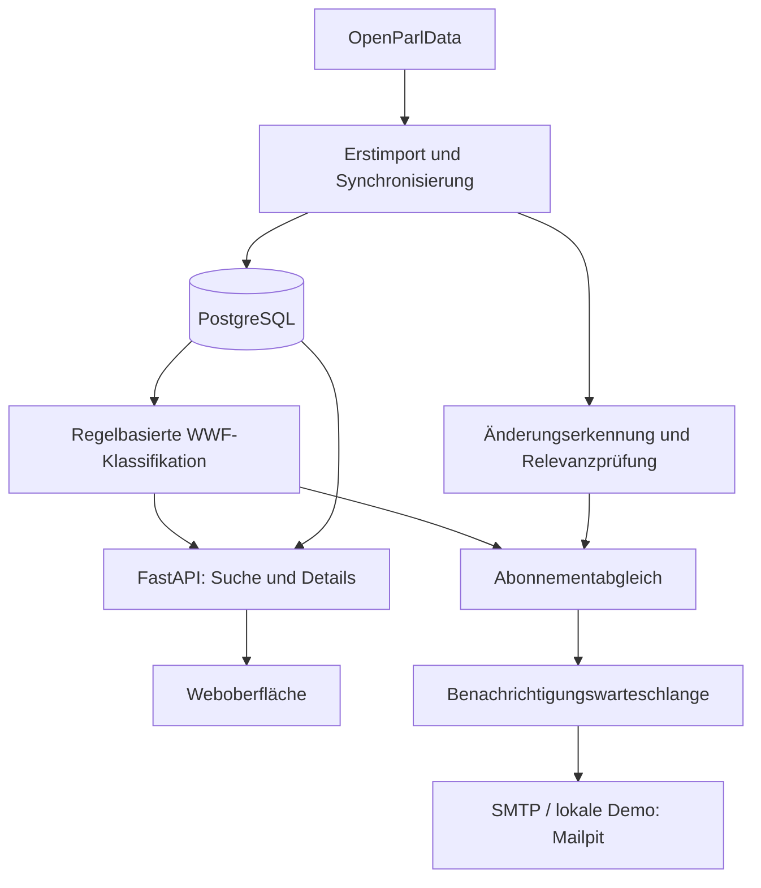

# WWF Polit-Assistant

[](https://github.com/FatihHayyar/wwf-polit-assistant/actions/workflows/ci.yml)

**Parlamentarische Entwicklungen finden, einordnen und verfolgen.**

Der WWF Polit-Assistant bündelt Schweizer Parlamentsdaten aus OpenParlData und macht sie nach WWF-Themen, Kantonen, Geschäftstypen, Datum und Suchbegriffen zugänglich – auch über Fragen in natürlicher Sprache. Zusammengehörige Geschäfte, Sitzungen, Traktanden und Dokumente lassen sich im politischen Kontext betrachten. Abonnements informieren per E-Mail über relevante neue Inhalte und Änderungen.

Das Projekt entsteht für **WWF Schweiz** im **Wirtschaftsprojekt (WIPRO)** des BSc Informatik an der **Hochschule Luzern (HSLU)**. Der aktuelle Stand ist ein funktionsfähiger Entwicklungs-MVP; die fachliche Abnahme und der Betrieb in der WWF-Umgebung stehen noch aus.

[Projektziele](#projektziele) · [Funktionen](#funktionen) · [Installation](#installation-und-test) · [Architektur](#architektur) · [Entwicklung](#lokale-entwicklung) · [Dokumentation](#dokumentation)

## Projektziele

Das MVP soll die politische Recherche und das Monitoring für WWF vereinfachen:

- **Relevante Inhalte finden:** parlamentarische Daten nach Themen, Kantonen, Geschäftstypen und individuellen Suchbegriffen durchsuchen oder als Frage formulieren.
- **Zusammenhänge verstehen:** zu einem Geschäft auch die zugehörigen Termine, Ereignisse, Abstimmungen und Dokumente sehen.
- **Entwicklungen verfolgen:** mehrere Abonnements mit eigenen Filterkombinationen anlegen oder einzelne Einträge mit einem Klick verfolgen und über relevante Veränderungen informiert werden.
- **Eine anschlussfähige Grundlage schaffen:** dokumentierte API, strukturierte Daten und eine containerisierte Python-Anwendung für die spätere Integration in die WWF-Systemlandschaft.

Die Themenklassifikation und die dialogorientierte Abfrage arbeiten regelbasiert und nachvollziehbar. Beide besitzen eine definierte Schnittstelle, an der später ein Sprachmodell angeschlossen werden kann ([KI-Erweiterung](docs/03-architecture/system-architecture.md#erweiterungspunkte-für-ki)).

## Funktionen

### Recherche in neun Bereichen

Jeder Bereich besitzt eine eigene Liste und eigene Filter. Beim Wechsel bleiben die jeweiligen Filter erhalten. Ein Klick auf einen Eintrag öffnet seine Details und die verfügbaren Verbindungen zu anderen Datensätzen.

Der Änderungsverlauf eines Geschäfts zeigt die Titel der betroffenen Inhalte und öffnet vorhandene Einträge direkt. Mehrfache Zuordnungen desselben Quelldokuments werden zusammengefasst; unterschiedliche Dokumente und inhaltliche Aktualisierungen bleiben getrennt sichtbar. Die Schliessen-Schaltfläche langer Detailansichten bleibt beim Scrollen erreichbar.

| Bereich | Inhalt und Zusammenhang |
|---|---|
| **Geschäfte** (`affairs`) | Parlamentarische Vorstösse und Geschäfte mit Status, Klassifikation und zugehörigen Vorgängen |
| **Traktanden** (`agendas`) | Tagesordnungspunkte mit Verbindung zur Sitzung und gegebenenfalls zum Geschäft |
| **Sitzungen** (`meetings`) | Parlamentarische Termine, Sitzungsinformationen und zugehörige Traktanden |
| **Abstimmungen** (`votings`) | Abstimmungsfragen und aggregierte Ergebnisse mit verfügbaren Geschäfts- und Sitzungsbezügen |
| **Ereignisse** (`events`) | Schritte im parlamentarischen Verlauf, etwa Einreichung oder Behandlung eines Geschäfts |
| **Dokumente** (`documents`) | Publizierte Unterlagen, Quellenlinks und vorhandener extrahierter Inhalt |
| **Texte** (`texts`) | Parlamentarische Textinhalte mit Bezug zum jeweiligen Geschäft |
| **Gruppen** (`groups`) | Parlamentarische Gremien und Gruppen sowie verfügbare zugehörige Sitzungen |
| **Interessenbindungen** (`interests`) | Deklarierte Interessen mit Informationen zur zugehörigen Person |

Die Suche kombiniert **Suchbegriff, Hauptthema, Unterthema, Kanton, Geschäftstyp (z. B. Motion, Postulat, Interpellation) und Datumsbereich**. Der Geschäftstyp-Filter erscheint nur im Bereich Geschäfte. Ergebnisse werden serverseitig paginiert. Die Oberfläche unterstützt **Deutsch, Französisch, Italienisch und Englisch**; parlamentarische Originaltexte werden nicht automatisch übersetzt.

Themenetiketten zeigen **Hauptthema / Unterthema**, beispielsweise **Klima & Energie / Sonstiges**. Dieses lokale Sonstiges bezeichnet einen passenden Hauptbereich ohne spezifisches Unterthema; das globale Sonstiges bezeichnet Inhalte ohne erkannte WWF-Zuordnung.

In der Bereichs- und bereichsübergreifenden Suche werden Geschäfte mit gleichem normalisiertem Titel, gleicher Körperschaft und gleichem Kalendertag als eine Ergebniskarte zusammengefasst. Beispielsweise bleiben Regierungsbotschaft und Gesetzesentwurf über getrennte Schaltflächen erreichbar. Die Originaldatensätze, IDs und Detailansichten bleiben erhalten; Trefferzahl und Pagination zählen die Gruppen. Das ist eine Darstellungsregel und keine nachgewiesene fachliche Identität der Quellen. Andere Tage oder Körperschaften bleiben getrennt.

### Fragen in natürlicher Sprache

Über dem Suchformular lässt sich eine Frage stellen, etwa «Motionen zum Wolf im Wallis seit 2024» oder «Séances au Grand Conseil de Genève le mois dernier». Die Anwendung erkennt Bereich, WWF-Thema (über dieselben Regeln wie die Klassifikation), Kanton, Geschäftstyp, Zeitraum und Suchbegriffe in Deutsch, Französisch, Italienisch und Englisch. Sie zeigt an, was sie verstanden hat, setzt die Filter im Suchformular und nennt die Trefferzahl. Angemeldete Nutzer können die Frage direkt als Abonnement speichern.

Die Erkennung ist regelbasiert: Sie erfindet keine Antworten, sondern übersetzt die Frage in nachprüfbare Filter. Nicht erkannte Teile bleiben sichtbar und lassen sich im Formular korrigieren.

### Konfigurierbare WWF-Themen

Die vier Hauptbereiche **Klima & Energie**, **Biodiversität & Landschaft**, **Nachhaltige Wirtschaft & Konsum** und **Umwelt & Politik** besitzen jeweils eine Sonstiges-Unterkategorie. Namen, Hierarchie, Synonyme, Regeln und Schwellenwerte werden in [taxonomy.json](app/classification/taxonomy.json) gepflegt. Die Oberfläche übernimmt die konfigurierten Namen aus der Kategorien-API.

Die aktuelle Version `rule-based-v8` erkennt eindeutige Titelbegriffe auch in Zusammensetzungen und mit Buchstaben-Endungen. Generische Begriffe benötigen einen ausdrücklichen Umweltbezug; Ausschlussregeln verhindern bekannte Fehltreffer (z. B. Ortsnamen). Rechenzentren und Grossverbraucher sind eigene Unterthemen, die Vorbildfunktion der öffentlichen Hand gehört zu Klima & Energie. Mehrere Themen können gleichzeitig passen; spezifische Unterthemen verdrängen den lokalen Fallback ihres Hauptthemas. Übersetzungen und Synonyme zählen als ein Konzept. Details und Befehle: [Klassifikationskonzept](docs/04-technical-concepts/classification-concept.md) und [Konfiguration](docs/configuration.md#regelbasierte-klassifikation).

### Abonnements und E-Mail-Monitoring

Die Recherche ist ohne Konto zugänglich. Für Benachrichtigungen registrieren sich Nutzer per E-Mail und melden sich über einen zeitlich begrenzten Link an. Optional steht eine konfigurierte Google-Anmeldung zur Verfügung. In der Abonnementverwaltung können bis zu zehn Benachrichtigungsadressen ausgewählt werden; zusätzliche Adressen benötigen eine Bestätigung.

Jedes Konto kann **bis zu zehn Abonnements** führen, z. B. «Energie in Luzern» und «Bioenergie in allen Kantonen». Ein Abonnement kombiniert WWF-Themen, Kantone, Geschäftstypen und Datenbereiche; sein Name entsteht automatisch aus der Auswahl. Es lässt sich pausieren, bearbeiten und löschen. Hauptthemen schliessen ihre Unterthemen ein. Innerhalb eines Abonnements gelten mehrere Werte einer Filtergruppe als Alternativen, verschiedene Gruppen müssen gemeinsam passen. Eine Änderung wird gemeldet, sobald **eines** der aktiven Abonnements passt; passen mehrere, kommt trotzdem nur eine Nachricht. Zusätzlich lässt sich jeder Eintrag in seiner Detailansicht mit **☆ Verfolgen** einzeln beobachten, unabhängig von den Abonnements.

Die Anwendung speichert Quelldatenänderungen getrennt von ihrer Benachrichtigungsrelevanz. Technische Metadaten, reine Formatänderungen und bestimmte geringfügige Textkorrekturen sollen keine E-Mail auslösen. Relevante Updates werden pro Nutzer und Geschäft beziehungsweise eigenständigem Eintrag zusammengefasst.

Benachrichtigungen besitzen eine HTML-Ansicht mit Inhaltskarten und eine separate Klartextfassung. Der Betreff benennt beispielsweise ein neues Dokument; Dokumentlinks, Geschäftsverlauf und Abonnementverwaltung sind eindeutig beschriftet. Bereits zugestellte E-Mails werden nicht verändert oder automatisch erneut versandt. Eine Aktualisierung ohne passende neue Entwicklung erzeugt keine neue Nachricht.

## Projektstand – 21. Oktober 2026

Datenimport, Synchronisierung aller neun Bereiche, konfigurierbare regelbasierte Klassifikation, Recherche mit Geschäftstyp-Filter, dialogorientierte Abfrage, verknüpfte Detailansichten, passwortlose Anmeldung, mehrere Abonnements pro Konto, Ein-Klick-Verfolgen und E-Mail-Benachrichtigungen sind umgesetzt. Präsentation, fachliche Bewertung durch WWF und formale Abnahme stehen aus. Die Azure-Bereitstellung selbst übernimmt WWF; das Projekt liefert dafür ein vorbereitetes Container-Setup und eine [Integrationsanleitung](docs/03-architecture/azure-integration.md).

| Bereich | Stand und Nachweis |
|---|---|
| Datenbestand | 2'958'331 Inhaltsdatensätze in neun Bereichen (21. Oktober). Alle Bereiche am 21. Oktober mit der neuen Sync-Strategie abgeglichen; Quellstichprobe vom 12. Oktober mit 4'500 Datensätzen ohne Abweichung ([Prüfung](docs/05-testing/review-2026-10-12.md)) |
| Synchronisierung | Nur Änderungen, neue und fehlende IDs werden gelesen; vollständige Vergleiche laufen je Bereich in festen Abständen. Der tägliche Geschäftsabgleich dauert Sekunden statt über einer Stunde ([Strategie](docs/monitoring.md#synchronisierungsstrategie)) |
| Klassifikation | `rule-based-v8` auf allen Datensätzen. Entwicklungsset 50/50 (Regeln daran verbessert). **Unabhängiges Prüfset B (300 Zufallsgeschäfte, vor der Messung annotiert): Precision 1.0, Recall 0.667** (v7 auf demselben Set: Recall 0.361). Rund ein Drittel der relevanten Geschäfte wird weiterhin übersehen ([Auswertung](docs/05-testing/evidence/holdout-evaluation.md)) |
| Sicherheit | Gleiche Antwort für bekannte und unbekannte Adressen, Ratenbegrenzung für E-Mail-, Token- und Frage-Endpunkte sowie für Bestätigungs-E-Mails bei Abonnementänderungen, Bestätigungsseite statt Token-Verbrauch beim Öffnen eines Links, Widerruf aller Tokens beim Abmelden, strikte Sicherheits-Header, Container ohne Root-Rechte ([Details](docs/monitoring.md#anmeldung-und-schutz-vor-missbrauch)) |
| Tests | 161 isolierte Backend-, API-, Sync- und Klassifikationstests (Stand 5. November), Frontend-Prüfungen und CI (Lint, Migrationen auf PostgreSQL 17, Docker-Build). Browser-Durchlauf der Demo inkl. Frage, zwei Abonnements, Testbenachrichtigung und Abmeldung am 21. Oktober |
| Demo | Ein-Kommando-Start mit Beispieldaten und Mailpit; Benachrichtigungen lassen sich mit einem Testgeschäft direkt ausprobieren |

Automatisierte Tests und Stichproben ersetzen keine WWF-Abnahme. Frühere Nachweise: [Prüfung vom 13. Oktober](docs/05-testing/review-2026-10-13.md), [Testergebnisse](docs/05-testing/test-results.md), [Aufgabenstand](docs/01-project-management/current-status.md).

## Installation und Test

Zum Ausprobieren gibt es eine **Demo** mit einem Ausschnitt der Daten (die Geschäfte, Sitzungen, Abstimmungen und Dokumente des letzten Jahres, Dokumenttexte gekürzt). Sie läuft mit oder ohne Docker; der ZIP-Download auf GitHub (**«Code → Download ZIP»**) ersetzt Git.

| Variante | Benötigt | Speicher | Dauer beim ersten Mal |
|---|---|---|---|
| [Demo mit Docker](docs/installation/1-demo-docker.md) (empfohlen) | Docker Desktop | ca. 4 GB | ca. 15–20 Min. |
| [Demo ohne Docker und Git](docs/installation/2-demo-ohne-docker.md) | Python, PostgreSQL, Mailpit (Windows) | ca. 3 GB | ca. 30–45 Min. |
| [Vollständige Installation](docs/installation/3-vollinstallation.md) | Git, Docker Desktop, Python, 16 GB RAM | ca. 50 GB | mehrere Stunden |

Die Demo läuft lokal mit einem Testpostfach (Mailpit), es werden keine echten E-Mails versendet. Nach dem Start helfen die [ersten Schritte](docs/installation/erste-schritte.md) beim Ausprobieren von Suche, Abonnements und Benachrichtigungen. Die vollständige Installation mit allen Daten von OpenParlData (rund 3 Millionen Einträge) entspricht dem Betrieb und richtet sich an technisch Verantwortliche.

**Kurzstart mit Git und Docker:**

[Docker Desktop](https://www.docker.com/products/docker-desktop/) installieren (für private Nutzung kostenlos), starten und warten, bis «Engine running» angezeigt wird. Danach:

```sh
git clone https://github.com/FatihHayyar/wwf-polit-assistant.git
cd wwf-polit-assistant
docker compose -f docker-compose.demo.yml up --build -d
```

Danach [localhost:8081](http://localhost:8081) (Anwendung) und [localhost:8025](http://localhost:8025) (Testpostfach) öffnen.

## Architektur

Import und laufende Synchronisierung führen die Quelldaten in PostgreSQL zusammen. Die Klassifikation unterstützt Recherche und Abonnementabgleich. Eine separate Relevanzprüfung entscheidet, welche gespeicherten Änderungen Benachrichtigungen erzeugen.



### Technologie-Stack

| Baustein | Umsetzung |
|---|---|
| Backend | Python 3.13, FastAPI, Pydantic |
| Datenzugriff | SQLAlchemy, Psycopg |
| Datenbank | PostgreSQL 17 |
| Migrationen | Alembic |
| Frontend | HTML, CSS und JavaScript-Module ohne Build-Schritt, von FastAPI ausgeliefert |
| API-Dokumentation | OpenAPI / Swagger |
| Ausführung | Docker und Docker Compose |
| Regelmässige Jobs | Python-Scheduler, täglich 04:30 Europe/Zurich (`SYNC_TIME`) |
| Qualitätssicherung | unittest, FastAPI-TestClient, Node-Prüfungen, ruff, GitHub Actions |
| E-Mail | SMTP; Mailpit im Docker-Demo-Setup |

### Datenmodell und Klassifikation

Die normalisierten Daten bilden direkte und indirekte Beziehungen zwischen Geschäften, Traktanden, Sitzungen und weiteren Inhalten ab. Kantone werden unter anderem über das parlamentarische Organ aufgelöst: `affairs.body_id → bodies.id → bodies.canton_key`.

Die konfigurierbare Klassifikation verwendet hierarchische Kategorien, mehrsprachige Regeln, Gewichte, Scores, Konfidenzwerte und Klassifikationsevidenz. Verknüpfte Inhalte können die Klassifikation des zugehörigen Geschäfts ergänzen; andere Datensätze besitzen zusätzlich eigene Klassifikationen.

Der Themenbaum umfasst Klima & Energie (mit Rechenzentren, Grossverbrauchern und der Vorbildfunktion der öffentlichen Hand), Biodiversität & Landschaft, nachhaltige Wirtschaft & Konsum, Umwelt & Politik sowie eine Auffangkategorie. Er folgt den Rückmeldungen von WWF; die endgültige fachliche Bestätigung durch die WWF-Fachexperten steht aus.

### Datenbestand

Lokaler Bestand nach dem Abgleich vom **21. Oktober 2026**. Beim Quellenvergleich vom 12. Oktober stimmten die API-Gesamtzahlen je Bereich mit den lokalen Zeilenzahlen überein; zusätzlich wurde eine Inhaltsstichprobe verglichen.

| Bereich | Lokale Zeilen |
|---|---:|
| Geschäfte | 326.499 |
| Traktanden | 423.580 |
| Sitzungen | 33.711 |
| Abstimmungen | 79.061 |
| Ereignisse | 918.113 |
| Dokumente | 912.005 |
| Texte | 226.086 |
| Gruppen | 8.891 |
| Interessenbindungen | 30.385 |

Die Dokumenttabelle enthält **905.847 unterschiedliche Quell-IDs**: mehrere Zeilen können unterschiedliche Zuordnungen desselben Quelldokuments repräsentieren. Referenzdaten wie Bodies, Persons und Memberships sowie die separate Demo-Datenbank sind in dieser Tabelle nicht mitgezählt.

Der vollständige Entwicklungsbestand und die kleine Docker-Stichprobe sind getrennte Datenbestände. Die folgenden Zahlen dokumentieren den ursprünglichen **Bootstrap vom 6. Oktober 2026**, nicht die aktuellen Datenbankzahlen.

<details>
<summary>Ursprünglichen Importbestand anzeigen</summary>

| Dataset | Datensätze |
|---|---:|
| Bodies | 2.411 |
| Persons | 26.864 |
| Memberships | 121.456 |
| Groups | 8.885 |
| Interests | 30.343 |
| Affairs | 325.691 |
| Meetings | 33.670 |
| Agendas | 422.971 |
| Events | 915.238 |
| Votings | 77.061 |
| Documents | 907.736 |
| Texts | 225.739 |
| **Gesamt** | **3.098.065** |

Der Erstimport umfasste ungefähr 126 komprimierte Dateien und 5,91 GB. Einzelne Stimmen parlamentarischer Mitglieder sind nicht Teil des lokalen Spiegels; aggregierte Abstimmungsergebnisse sind im Dataset `votings` verfügbar.

Alle 325.691 ursprünglichen Geschäfte wurden klassifiziert. Der damalige Stand umfasste 325.824 Klassifikationszeilen, 7.111 Evidenzzeilen und 320.121 Auffangklassifikationen. Diese historischen Zahlen sind keine Messung der fachlichen Klassifikationsqualität.

</details>

## Synchronisierung und Benachrichtigungen

Regelanpassungen und historische Neuberechnung sind vom Sync getrennt: `python -m scripts.reclassify_rules` ist eine schreibgeschützte Vorschau; `--apply` verarbeitet den Bestand nach bestandenem Entwicklungsset. `--dataset`, `--limit` und `--workers` begrenzen Umfang und Parallelität. Nach Taxonomieänderungen `--force` verwenden. Die Qualitätsschranke benötigt Git-Historie mit dem festgelegten Baseline-Commit; ein ZIP ohne `.git` reicht dafür nicht. Weitere Voraussetzungen und die älteren Einzeljobs stehen in der [Konfiguration](docs/configuration.md#regelbasierte-klassifikation).

Alle neun Bereiche laufen über einen gemeinsamen Ablauf ([entity_sync.py](scripts/sync/entity_sync.py)); die Bereichsmodule enthalten nur noch Quelle und Feldzuordnung. Jeder Lauf besteht aus bis zu vier Phasen:

| Phase | Was gelesen wird | Bereiche |
|---|---|---|
| Änderungen | Datensätze mit `updated_at` nach dem Checkpoint (absteigend sortiert, Nullwerte ausgeschlossen) | alle ausser Traktanden |
| Zeitfenster | Traktanden mit Sitzungsdatum ±60 Tage, da die Quelle für Traktanden kein Änderungsdatum liefert | Traktanden |
| Neue IDs | IDs oberhalb der höchsten lokalen ID | alle |
| Fehlende IDs | nur IDs, die lokal fehlen (Dokumente über gezielte ID-Abfragen) | alle |

Ein **vollständiger Vergleich** liest den ganzen Bestand und erkennt auch Änderungen, die die Quelle nicht mit einem neuen Änderungsdatum markiert. Er läuft je Bereich in festen Abständen (`FULL_SCAN_DAYS`, z. B. Abstimmungen und Ereignisse wöchentlich, Geschäfte monatlich; Dokumente werden wegen ihres Umfangs nur über Änderungen und ID-Lücken abgeglichen) und wird in `sync_checkpoints.last_full_scan_at` vermerkt. `--recheck` erzwingt ihn.

`CHANGED` bedeutet eine gespeicherte Inhaltsänderung und führt nicht automatisch zu einer E-Mail. Fingerprints und Normalisierung reduzieren technische Unterschiede; die Benachrichtigungsregeln bewerten zusätzlich die fachliche Bedeutung.

Verarbeitete Seiten werden gespeichert. Fortschritt und abgeschlossene Dataset-Schritte ermöglichen die Wiederaufnahme unterbrochener Jobs. Ein PostgreSQL-Advisory-Lock schützt den gemeinsamen Runner vor paralleler Ausführung.

```powershell
python -m scripts.sync.run_all
```

Der separat gestartete Scheduler führt den Job täglich um **04:30 Europe/Zurich** aus (`SYNC_TIME`). OpenParlData erzeugt seine Tagesexporte gegen 02:15 UTC; der Lauf danach erfasst die Änderungen der Nacht noch am selben Tag. Die Entwicklungsphase unterstützt ausserdem einen geschützten API-Start im Hintergrund, Statusabfragen, Logs und Abbruch. Laufberichte und Logs werden unter `logs/` gespeichert. Der Compose-Scheduler bindet dieses Verzeichnis als `/app/logs` ein, damit Fortschritt und Berichte beim Ersetzen des Containers erhalten bleiben und von der API gelesen werden können.

Relevante Änderungen an Traktanden, Sitzungen, Abstimmungen, Ereignissen, Dokumenten und Texten werden den verbundenen Geschäften zugeordnet. Der Versand erfolgt nach erfolgreichem Abschluss der Dataset-Schritte. Vor dem Senden werden Konto und Abonnement erneut geprüft. Fehlgeschlagene Sendungen bleiben zur erneuten Verarbeitung ausstehend; nicht mehr passende Benachrichtigungen können verworfen werden.

Der Standardversand besitzt **keine Gesamtgrenze von 100 Nachrichten**. Interne Batches dienen der Verarbeitung. Die Zusammenfassung erfolgt pro Nutzer und Geschäft oder eigenständigem Eintrag, nicht als eine einzige tägliche E-Mail pro Nutzer. SMTP-Limits und Versandvolumen bleiben betriebliche Prüfpunkte.

Checkpoint-Verhalten, Abbruch, Wiederaufnahme und die Regeln je Dataset sind im [Monitoring-Leitfaden](docs/monitoring.md) beschrieben.

### Warum bleibt das Checkpoint-Datum unverändert?

Ein Checkpoint ist eine **Position in der Datenquelle**, kein Zeitstempel des zuletzt gestarteten Jobs:

| Feld | Bedeutung |
|---|---|
| `last_updated_at` + `last_id` | Zuletzt erfolgreich verarbeitete Quellposition (Änderungsdatum und ID); bei Traktanden nur die höchste ID |
| `last_run_at` | Zeitpunkt des letzten gespeicherten Dataset-Abgleichs, auch ohne neue Inhalte; Erfolg zusätzlich über Status und Laufbericht prüfen |
| `last_full_scan_at` | Letzter vollständiger Vergleich des Bereichs; bestimmt, wann der nächste fällig ist |

Beispiel vom 21. Oktober: Der Geschäfts-Checkpoint steht auf **21.10.2026, 04:02:44 / ID 341748**, der Abgleich lief um 13:36. Die Quellposition entspricht dem jüngsten Änderungsdatum in der Quelle, nicht der Laufzeit. Vor der neuen Strategie blieben die Checkpoints einiger Bereiche (z. B. Dokumente auf dem 11. Oktober) stehen, weil Bestandsvergleiche den Cursor nicht fortschrieben; das ist behoben.

Den Quellcursor auf die aktuelle Uhrzeit zu setzen wäre falsch: dadurch könnten später bereitgestellte Inhalte mit älteren Quellzeitstempeln übersprungen werden. Letzte Kontrollzeit, Quellposition und `NEW`/`CHANGED` sind daher getrennt zu lesen. Der aktuelle Befund lautet **keine weiteren Unterschiede in den abgeschlossenen Läufen und der Quellenstichprobe**; er beweist nicht, dass OpenParlData während des gesamten Tages weltweit keine Änderungen hatte.

## REST API

Die interaktive Dokumentation wird aus der Anwendung erzeugt: **`/docs`**; die OpenAPI-Spezifikation liegt unter **`/openapi.json`**.

| Funktion | Endpunkte |
|---|---|
| Bereichssuche | `GET /api/v1/entities/{dataset}` |
| Details und Beziehungen | `GET /api/v1/entities/{dataset}/{record_id}` |
| Geschäftssuche und Details | `GET /api/v1/affairs`, `GET /api/v1/affairs/{affair_id}` |
| Filterwerte | `GET /api/v1/categories`, `GET /api/v1/cantons`, `GET /api/v1/affair-types` |
| Registrierung und Verifikation | `POST /api/v1/auth/register`; Link: `GET /api/v1/auth/verify-email` (Bestätigungsseite), `POST` auf demselben Pfad (Bestätigung) |
| Anmeldung per E-Mail | `POST /api/v1/auth/login`; Link: `GET`/`POST /api/v1/auth/verify-login` |
| Optionale Google-Anmeldung | `GET /api/v1/auth/providers`, `GET /api/v1/auth/google`, `GET /api/v1/auth/google/callback` |
| Konto, Logout und Löschung | `GET /api/v1/auth/me`, `POST /api/v1/auth/logout`, `DELETE /api/v1/auth/me` |
| Abonnements | `GET /api/v1/subscriptions` (Übersicht), `POST /api/v1/subscriptions/profiles`, `PUT`/`DELETE /api/v1/subscriptions/profiles/{id}`, `DELETE /api/v1/subscriptions` (alle beenden) |
| Frage in natürlicher Sprache | `POST /api/v1/ask` |
| Einzelne Inhalte verfolgen | `PUT /api/v1/subscriptions/watches/{dataset}/{record_id}`, `DELETE` auf demselben Pfad |
| Benachrichtigungsadressen | `GET /api/v1/subscriptions/recipients`, `PUT` auf demselben Pfad; Bestätigung über `GET`/`POST /recipients/verify` |
| Demo-Testbenachrichtigung (nur `DEMO_MODE`) | `GET /api/v1/demo/status`, `GET /api/v1/demo/topics`, `POST /api/v1/demo/notifications` |
| Sync starten | `POST /api/v1/sync/run` |
| Checkpoints und letzter Lauf | `GET /api/v1/sync/status`, `GET /api/v1/sync/latest` |
| Laufstatus und Logs | `GET /api/v1/sync/runs/{run_id}`, `GET /api/v1/sync/runs/{run_id}/log` |
| Lauf abbrechen | `POST /api/v1/sync/runs/{run_id}/cancel` |
| Unfertigen Lauf fortsetzen | `POST /api/v1/sync/runs/{run_id}/resume` |
| Verfügbarkeit | `GET /health` |

Beispiel einer Bereichssuche:

```http
GET /api/v1/entities/agendas?q=Photovoltaik&canton=ZH&page=1
```

Themen, Unterthemen, Geschäftstyp (`affair_type`, nur Geschäfte) und Datumsfilter lassen sich ergänzen. Die Standardseitengrösse beträgt zehn Treffer. Textsuche verwendet je nach Dataset PostgreSQL-Trigramm- oder Volltextindizes; externe Dokumentanhänge werden dadurch nicht automatisch heruntergeladen.

Beispiel eines Abonnements (`POST /api/v1/subscriptions/profiles`):

```json
{
  "category_ids": [1],
  "canton_keys": ["LU"],
  "affair_types": ["Motion"]
}
```

Kategorie-IDs werden über die Kategorien-API ermittelt, Geschäftstypen über `GET /api/v1/affair-types`. Der Name (hier z. B. «Klima & Energie · Luzern · Motion») wird aus den Filtern erzeugt. Ein Hauptthema umfasst seine Unterkategorien. Leere Filtergruppen schränken die jeweilige Dimension nicht ein; ein Abonnement ohne Themen, Kantone und Geschäftstypen ist pausiert. Einzelne Record-Watches werden separat verwaltet.

| Abonnement | Themen | Kantone | Geschäftstypen | Bedeutung |
|---|---|---|---|---|
| 1 | Klima & Energie | LU | Alle | Passende Entwicklungen im Kanton Luzern |
| 2 | Bioenergie | Alle | Alle | Bioenergie in allen Kantonen |
| 3 | Biodiversität & Landschaft | ZH | Motion, Postulat | Motionen und Postulate zur Biodiversität in Zürich |

Eine Änderung, die zu Abonnement 1 **oder** 2 **oder** 3 passt, erzeugt genau eine Benachrichtigung – auch ein Bioenergie-Geschäft aus Luzern, das zu 1 und 2 passt.

Die Anmeldung verwendet JWT und ein HttpOnly-Sitzungscookie für die Oberfläche; API-Clients können Bearer-Tokens verwenden. Abmelden widerruft alle bisher ausgestellten Tokens des Kontos. Registrierung mit einer bereits registrierten Adresse und Anmeldung mit einer unbekannten Adresse werden klar abgewiesen und führen zur richtigen Aktion (Entscheid D16); E-Mail- und Token-Endpunkte sind ratenbegrenzt (HTTP 429 mit `Retry-After`). Verwaltungsfunktionen erfordern Anmeldung, Sync-Operationen den separat konfigurierten Schlüssel im Header `X-Sync-API-Key`. Kontolöschung ist unterstützt.

## Lokale Entwicklung

Für Änderungen am Code werden **Python 3.13+** und **PostgreSQL** benötigt. Die Demo oben ist der einfachere Weg zum Ausprobieren.

### Umgebung vorbereiten

```powershell
python -m venv .venv
.\.venv\Scripts\Activate.ps1
pip install -e .
Copy-Item .env.example .env
```

In `.env` Datenbank, JWT, SMTP und `SYNC_API_KEY` konfigurieren. Zugangsdaten bleiben lokal. `docker-compose.yml` stellt PostgreSQL auf Port **5433** (nur von diesem Rechner erreichbar), einen Migrationsdienst, die API auf Port **8000** und den Scheduler bereit; `docker compose up -d --build` startet alles.

Für die optionale Google-Anmeldung zusätzlich `GOOGLE_CLIENT_ID` und `GOOGLE_CLIENT_SECRET` setzen. Der OAuth-Webclient benötigt `${VERIFICATION_BASE_URL}/api/v1/auth/google/callback` als erlaubte Weiterleitungs-URI, lokal `http://localhost:8000/api/v1/auth/google/callback`. Nach Neustart erscheint die Google-Schaltfläche; ohne Konfiguration bleibt die E-Mail-Anmeldung verfügbar. Weitere Einstellungen: [Konfiguration](docs/configuration.md).

```powershell
docker compose up -d postgres
python -m alembic upgrade head
python -m uvicorn app.main:app --reload
```

Oberfläche: **http://localhost:8000** · API-Dokumentation: **http://localhost:8000/docs**.

Eine leere Entwicklungsdatenbank benötigt anschliessend den Datenimport und die Klassifikationsvorbereitung. Migrationen allein laden keine parlamentarischen Inhalte. Die Demo-Datenbank und ihr Startskript gehören zur separaten Demo-Konfiguration.

### Erstimport und Klassifikation

Der Bootstrap lädt Exporte und importiert sie in das normalisierte Schema. Er ist für eine frische Zieldatenbank vorgesehen: vorhandene Tabellen können dabei zurückgesetzt werden. Bestehende Daten vorher sichern.

```powershell
python scripts/bootstrap/download_openparldata.py --dry-run
python scripts/bootstrap/download_openparldata.py --workers 6
python scripts/bootstrap/import_normalized.py all
python -m scripts.seed_classification
python -m scripts.rule_quality
python -m scripts.reclassify_rules --apply
python -m scripts.rule_backfill_status
```

Dies sind Schritte der Importpipeline, keine vollständige Ein-Kommando-Installation des normalisierten Datenbestands. Klassifikationsvorbereitung und historische Entity-Klassifikation sind im [Monitoring-Leitfaden](docs/monitoring.md) dokumentiert. Vollständige Raw-Downloads und Datenbank-Backups werden nicht ins Repository aufgenommen; die kuratierte öffentliche Demo-Stichprobe liegt unter [data/demo](data/demo/README.md).

### Tests

Die Backend-Suite verwendet isolierte Fixtures/Mocks. In einem eigenen Testterminal ausführen:

```powershell
$env:DATABASE_URL = 'sqlite://'
$env:JWT_SECRET_KEY = 'isolated-test-key-only-not-for-production'
python -B -m unittest discover -s tests -p 'test_*.py'
node tests/test_frontend.cjs
python -m scripts.evaluate_holdout
```

Das Testterminal danach schliessen oder die beiden Variablen entfernen, bevor die echte Anwendung darin gestartet wird. Voraussetzungen und Browserabläufe: [Testplan](docs/05-testing/test-plan.md).

Die Tests decken unter anderem die Sync-Phasen, Beziehungen, Normalisierung, Klassifikation, Abonnements, die Fragenerkennung, Benachrichtigungsregeln, Anmeldung, Ratenbegrenzung, Sicherheits-Header und den Demo-Ablauf über den echten HTTP-Stack ab. `scripts.evaluate_holdout` misst die Klassifikation auf beiden blinden Prüfsets, ohne PostgreSQL zu benötigen. GitHub Actions führt bei jedem Push zusätzlich ruff, die Migrationen auf PostgreSQL 17 und den Docker-Build aus. Live-Sync und Organisations-SMTP wurden separat geprüft; die fachliche WWF-Abnahme steht aus.

## Grenzen und nächste Schritte

Die behobenen Sync-, Windows-Checkpoint-, SMTP- und Oberflächenprobleme werden nicht mehr als offene Aufgaben geführt. Weitere reguläre Läufe zu beobachten ist laufende Betriebskontrolle, kein Ersatz für die bereits durchgeführten erfolgreichen Prüfungen.

### Vor Präsentation und fachlichem Abschluss

| Aufgabe | Noch ausstehender Schritt |
|---|---|
| Fachliche Qualität | WWF-Taxonomie und Fokus Energie & Klima bestätigen; die Prüfsets von WWF-Fachpersonen nachannotieren lassen. Der Recall stieg von 0.36 (v7) auf 0.67 (v8, unabhängiges Prüfset B); die verbleibenden Fehler betreffen vor allem indirekte Formulierungen (z. B. «Nachtabschaltung der Strassenbeleuchtung», «Fischtreppe»). Nach weiteren Regeländerungen ein neues Prüfset ziehen |
| Demonstration | Präsentation und nachvollziehbare Beispiele für Suche, Beziehungen, Abonnements und relevante Änderungen vorbereiten |
| WWF-Feedback und Abnahme | Gemeinsamen Anwendungsfalldurchlauf durchführen; Rückmeldungen und tatsächliche Akzeptanz dokumentieren |
| Projektabschluss | Vorbereitete Ergebnis-/Übergabeunterlagen prüfen, formalen Kursbericht abschliessen und tatsächliche Übergabe durchführen |
| Softwarelizenz | Gewünschte Lizenz für den Anwendungscode festlegen |

### Bei einer späteren Übernahme durch WWF

Container, Konfiguration, Migrationen, Sicherung, API und Betriebsrollen sind dokumentiert. WWF muss für seine Umgebung insbesondere erreichbare HTTPS-Links, Organisations-SMTP, Secrets, Monitoring und Wiederherstellung festlegen und prüfen. Lokaler SMTP-Versand wurde erfolgreich nachgewiesen; ein WWF-Produktionsprovider ist damit noch nicht geprüft.

Der MVP liefert mit Python, PostgreSQL, Docker (ohne Root-Rechte, mit Healthcheck), OpenAPI und Umgebungsvariablen eine Grundlage für die Azure-Integration durch WWF; die [Azure-Anleitung](docs/03-architecture/azure-integration.md) beschreibt eine konkrete Zielarchitektur mit Azure Container Apps, Azure Database for PostgreSQL und Azure Files. Ein eigenes Azure-Deployment gehört nicht zum Lieferumfang; Kompatibilität mit der konkreten WWF-Umgebung wird nicht als bereits getestet ausgegeben. Lokale JSON-Laufberichte ersetzen kein zentrales Produktionsmonitoring. Harmonisierten Geschäftszuständen und Originalsprachen sind durch die Quellabdeckung Grenzen gesetzt.

### Optionale Weiterentwicklung

KI-gestützte Klassifikation, semantische Suche, Zusammenfassungen und ein Chat mit frei formulierten Antworten bleiben Erweiterungen. Die regelbasierte Fragenerkennung (`QueryInterpreter`) und die Klassifikation besitzen dafür definierte Schnittstellen; eine KI-Klassifikation lässt sich mit denselben Prüfsets direkt gegen die Regeln vergleichen. Ebenso optional sind ein täglicher Sammeldigest, weitergehende SMTP-Optimierungen und Organisations-SSO.

Die beiden grossen Indizes für die experimentelle bereichsübergreifende Suche können mit `python -m scripts.build_search_indexes` in einem Wartungsfenster aufgebaut werden. Die öffentliche Bereichsrecherche benötigt sie nicht. Ein GitHub-Projects-Board ist noch nicht erstellt; dafür fehlt die erforderliche Projects-Berechtigung. Bestehende Issues und Milestones können bereits genutzt werden.

## Dokumentation

Die Dokumentation ist nach Projektmanagement, Anforderungen, Architektur, technischen Konzepten, Tests, Übergabe und wissenschaftlicher Einordnung gegliedert. Einstieg: [Dokumentationsindex](docs/README.md). [GitHub-Tracking](docs/01-project-management/github-tracking.md) verknüpft Aufgaben und Milestones.

| Dokument | Inhalt |
|---|---|
| [Dokumentationsindex](docs/README.md) | Einstieg in alle Projektunterlagen |
| [Aktueller Aufgabenstand](docs/01-project-management/current-status.md) | Erledigte Prüfungen, verbleibende Abnahme und Abgleich der gestrigen Aufgaben |
| [Installation](docs/getting-started.md) | Entwicklungsumgebung und Erstimport für Entwickler; Schritt-für-Schritt-Anleitungen unter [docs/installation](docs/installation/) |
| [Benutzerhandbuch](docs/06-handover/user-guide.md) | Recherche, Fragen, Anmeldung und Abonnements |
| [Konfiguration](docs/configuration.md) | Umgebungsvariablen, Container, Google-Anmeldung und editierbare Klassifikation |
| [Architektur](docs/03-architecture/system-architecture.md) | Komponenten, Datenmodell und Ausführungsgrenzen |
| [API](docs/api.md) | Öffentliche Recherche und geschützte Verwaltungsrouten |
| [Tests](docs/05-testing/test-plan.md) | Automatisierte Prüfungen und manuelle Abnahme |
| [Klassifikation auf den Prüfsets](docs/05-testing/evidence/holdout-evaluation.md) | Zwei blind annotierte Stichproben mit Precision, Recall und Fehlerliste |
| [Betrieb](docs/06-handover/deployment-guide.md) | Prozessrollen, Migrationen und Sicherung |
| [Fehlerbehebung](docs/troubleshooting.md) | Sync-, Anmelde- und Installationsprobleme |
| [Mitwirken](CONTRIBUTING.md) | Beiträge und Pull Requests |
| [Sicherheit](SECURITY.md), [Support](SUPPORT.md) | Meldewege und Hilfe |
| [Änderungsprotokoll](CHANGELOG.md), [Lizenzen](docs/licensing.md) | Arbeitsstand und offene Lizenzentscheidung |
| [Betrieb und Monitoring](docs/monitoring.md) | Lokaler Start, Klassifikationsvorbereitung, Abonnements, Sync-Strategie und Benachrichtigungsregeln |
| [Azure-Integration](docs/03-architecture/azure-integration.md) | Zielarchitektur und Schritte für den Betrieb in Azure |
| [WWF-Anforderungen](docs/wwf-requirements.md) | Zuordnung der Auftraggeberanforderungen und offene fachliche Entscheidungen |
| [Review vom 11. Oktober 2026](docs/daily-review-2026-10-11.md) | Historischer Befund mit aktualisierter Erledigungsübersicht; keine aktuelle offene Fehlerliste |
| [Demo-Stichprobe](data/demo/README.md) | Herkunft, Umfang und Erneuerung der Beispieldaten |

<details>
<summary>Frühere Integrationsnachweise vom 8. Oktober 2026</summary>

Ein damaliger manueller Lauf schloss sieben Sync-Module in 24,24 Sekunden mit null neuen Datensätzen, Änderungen und Fehlern ab. Dieser Lauf dokumentiert den früheren Implementierungsstand und beweist keine vollständige oder dauerhaft zuverlässige Aktualisierung.

Ein kontrollierter Benachrichtigungstest verwendete das Berner Geschäft **#18792**, «Komplettierung Solaranlage Schiessanlage Weier», klassifiziert unter **Erneuerbarer Strom → Klima & Energie**. Das passende Abonnement erzeugte eine Benachrichtigung; eine reale SMTP-E-Mail wurde zugestellt. Temporäre Testereignisse und Benachrichtigungen wurden anschliessend entfernt.

</details>

## Datenquelle und Lizenz

Parlamentarische Daten stammen von **[OpenParlData.ch](https://openparldata.ch/)** und stehen unter **CC BY 4.0**. Die Demo enthält keine bestehenden Benutzerkonten, Abonnements, E-Mail-Tokens oder Versandwarteschlangen.

Eine projektspezifische **Softwarelizenz** wurde noch nicht festgelegt; der [Lizenzleitfaden](docs/licensing.md) dokumentiert den Status. Die Lizenz der Quelldaten und die Lizenz des Anwendungscodes sind getrennt zu betrachten.
