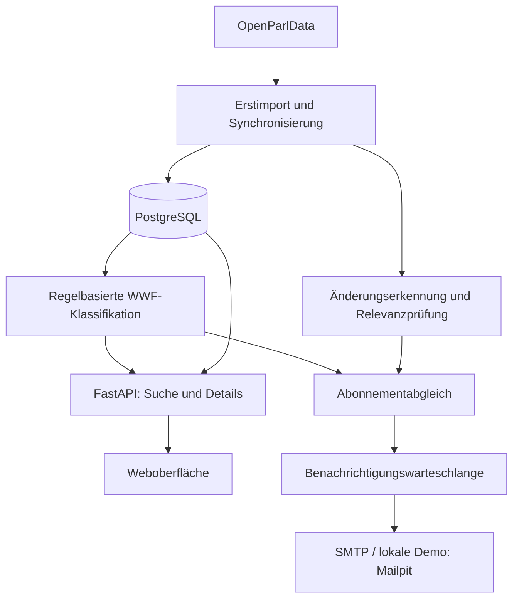

# WWF Polit-Assistant

**Parlamentarische Entwicklungen finden, einordnen und verfolgen.**

Der WWF Polit-Assistant bündelt Schweizer Parlamentsdaten aus OpenParlData und macht sie nach WWF-Themen, Kantonen, Datum und Suchbegriffen zugänglich. Zusammengehörige Geschäfte, Sitzungen, Traktanden und Dokumente lassen sich im politischen Kontext betrachten. Abonnements informieren per E-Mail über relevante neue Inhalte und Änderungen.

Das Projekt entsteht für **WWF Schweiz** im **Wirtschaftsprojekt (WIPRO)** des BSc Informatik an der **Hochschule Luzern (HSLU)**. Der aktuelle Stand ist ein funktionsfähiger Entwicklungs-MVP; die fachliche Abnahme und der Betrieb in der WWF-Umgebung stehen noch aus.

[Projektziele](#projektziele) · [Funktionen](#funktionen) · [Demo starten](#quick-start-mit-docker) · [Architektur](#architektur) · [Entwicklung](#lokale-entwicklung) · [Dokumentation](#dokumentation)

## Projektziele

Das MVP soll die politische Recherche und das Monitoring für WWF vereinfachen:

- **Relevante Inhalte finden:** parlamentarische Daten nach Themen, Kantonen und individuellen Suchbegriffen durchsuchen.
- **Zusammenhänge verstehen:** zu einem Geschäft auch die zugehörigen Termine, Ereignisse, Abstimmungen und Dokumente sehen.
- **Entwicklungen verfolgen:** Themen abonnieren oder einzelne Einträge beobachten und über relevante Veränderungen informiert werden.
- **Eine anschlussfähige Grundlage schaffen:** dokumentierte API, strukturierte Daten und eine containerisierte Python-Anwendung für die spätere Integration in die WWF-Systemlandschaft.

Die Themenklassifikation erfolgt regelbasiert. KI, semantische Suche und dialogorientierte Abfragen sind mögliche Erweiterungen; sie sind im aktuellen MVP nicht umgesetzt.

## Funktionen

### Recherche in neun Bereichen

Jeder Bereich besitzt eine eigene Liste und eigene Filter. Beim Wechsel bleiben die jeweiligen Filter erhalten. Ein Klick auf einen Eintrag öffnet seine Details und die verfügbaren Verbindungen zu anderen Datensätzen.

| Bereich | Inhalt und Zusammenhang |
|---|---|
| **Geschäfte** (`affairs`) | Parlamentarische Vorstösse und Geschäfte mit Status, Klassifikation und zugehörigen Vorgängen |
| **Traktanden** (`agendas`) | Tagesordnungspunkte mit Verbindung zur Sitzung und gegebenenfalls zum Geschäft |
| **Sitzungen** (`meetings`) | Parlamentarische Termine, Sitzungsinformationen und zugehörige Traktanden |
| **Abstimmungen** (`votings`) | Abstimmungsfragen und aggregierte Ergebnisse mit verfügbaren Geschäfts- und Sitzungsbezügen |
| **Ereignisse** (`events`) | Schritte im parlamentarischen Verlauf, etwa Einreichung oder Behandlung eines Geschäfts |
| **Dokumente** (`documents`) | Publizierte Unterlagen, Quellenlinks und vorhandener extrahierter Inhalt |
| **Texte** (`texts`) | Parlamentarische Textinhalte mit Bezug zum jeweiligen Geschäft |
| **Gruppen** (`groups`) | Parlamentarische Gremien und Gruppen sowie verfügbare zugehörige Sitzungen |
| **Interessenbindungen** (`interests`) | Deklarierte Interessen mit Informationen zur zugehörigen Person |

Die Suche kombiniert **Suchbegriff, Hauptthema, Unterthema, Kanton und Datumsbereich**. Ergebnisse werden serverseitig paginiert. Die Oberfläche unterstützt **Deutsch, Französisch, Italienisch und Englisch**; parlamentarische Originaltexte werden nicht automatisch übersetzt.

### Abonnements und E-Mail-Monitoring

Die Recherche ist ohne Konto zugänglich. Für Benachrichtigungen registrieren sich Nutzer per E-Mail und melden sich über einen zeitlich begrenzten Link an.

Abonnements können WWF-Themen, Kantone, Suchbegriffe und Datenbereiche kombinieren. Zusätzlich lassen sich einzelne Einträge verfolgen. Hauptthemen schliessen ihre Unterthemen ein. Mehrere Werte innerhalb einer Filtergruppe gelten als Alternativen; Einschränkungen verschiedener Gruppen müssen gemeinsam passen.

Die Anwendung speichert Quelldatenänderungen getrennt von ihrer Benachrichtigungsrelevanz. Technische Metadaten, reine Formatänderungen und bestimmte geringfügige Textkorrekturen sollen keine E-Mail auslösen. Relevante Updates werden pro Nutzer und Geschäft beziehungsweise eigenständigem Eintrag zusammengefasst.

### Aktueller Stand

**Stand: 12. Oktober 2026.** Datenimport, neun Synchronisationsmodule, Klassifikation, Recherche, verknüpfte Detailansichten, passwortlose Anmeldung und Abonnementverwaltung sind implementiert. Die Benachrichtigungspipeline berücksichtigt auch Änderungen an verbundenen Datensätzen.

81 isolierte Backend-Regressionstests sowie Frontend- und Browserprüfungen wurden erfolgreich ausgeführt. Der Docker-Demostart, alle neun Listen- und Detail-APIs, die E-Mail-Verifikation über Mailpit und die Erhaltung der Daten beim Neustart wurden ebenfalls geprüft. Das ersetzt keine vollständige fachliche Abnahme oder Prüfung unter Produktionsbedingungen.

## Quick Start mit Docker

Für die lokale Demo werden **Docker Desktop** (gestartet) und **Git** benötigt. Alternativ kann das Repository als ZIP heruntergeladen werden. Eine separate Installation von Python oder PostgreSQL und eine eigene `.env` sind nicht erforderlich.

### 1. Repository herunterladen

```sh
git clone https://github.com/FatihHayyar/wwf-polit-assistant.git
cd wwf-polit-assistant
```

Bei einem ZIP-Download das Archiv entpacken und ein Terminal im Projektordner öffnen.

### 2. Anwendung starten

```sh
docker compose -f docker-compose.demo.yml up --build -d
```

Docker startet **FastAPI**, **PostgreSQL 17**, die **Alembic-Migrationen** und **Mailpit**. Der erste Start benötigt Internet für Images und Python-Pakete und kann einige Minuten dauern.

Eine leere Demo-Datenbank erhält automatisch **500 Beispieldatensätze pro Bereich** mit vorhandenen WWF-Klassifikationen. Zusätzliche verknüpfte Referenzdaten erhalten den Kontext der Detailansichten; deshalb enthalten einige Bereiche mehr als 500 Einträge. Die Stichprobe liegt bereits im Repository, ein vollständiger OpenParlData-Import ist nicht erforderlich.

Die Demo verwendet eine eigene Datenbank, erhält vorhandene Daten beim Neustart und startet keine tägliche Synchronisierung.

### 3. Anwendung öffnen

| Dienst | Adresse |
|---|---|
| Polit-Assistant | [localhost:8081](http://localhost:8081) |
| Swagger / OpenAPI | [localhost:8081/docs](http://localhost:8081/docs) |
| Lokale E-Mails (Mailpit) | [localhost:8025](http://localhost:8025) |

### Einen ersten Ablauf ausprobieren

1. Einen Bereich auswählen und nach einem Begriff oder WWF-Thema suchen.
2. Einen Treffer öffnen und seine verknüpften Inhalte ansehen.
3. **Registrieren** wählen und eine E-Mail-Adresse eingeben.
4. Den Bestätigungslink in **Mailpit** öffnen und anschliessend Abonnements verwalten.

Auch spätere Anmeldelinks erscheinen in Mailpit. Alle Demo-E-Mails bleiben lokal; externe SMTP-Zugangsdaten werden nicht benötigt. Parlamentarische Update-Benachrichtigungen entstehen erst bei einer Synchronisierung mit relevanten Änderungen, die Demo löst diese nicht automatisch aus.

### Logs und Beenden

```sh
docker compose -f docker-compose.demo.yml logs -f app
```

```sh
docker compose -f docker-compose.demo.yml down
```

Die PostgreSQL-Daten bleiben im Docker-Volume erhalten.

> `docker compose -f docker-compose.demo.yml down -v` löscht den lokalen Demo-Datenbestand. Nur verwenden, wenn die Demo bewusst zurückgesetzt werden soll.

## Architektur

Import und laufende Synchronisierung führen die Quelldaten in PostgreSQL zusammen. Die Klassifikation unterstützt Recherche und Abonnementabgleich. Eine separate Relevanzprüfung entscheidet, welche gespeicherten Änderungen Benachrichtigungen erzeugen.



### Technologie-Stack

| Baustein | Umsetzung |
|---|---|
| Backend | Python 3.13, FastAPI, Pydantic |
| Datenzugriff | SQLAlchemy, Psycopg |
| Datenbank | PostgreSQL 17 |
| Migrationen | Alembic |
| Frontend | HTML, CSS und JavaScript, von FastAPI ausgeliefert |
| API-Dokumentation | OpenAPI / Swagger |
| Ausführung | Docker und Docker Compose |
| Regelmässige Jobs | Python-Scheduler, 03:00 Europe/Zurich |
| E-Mail | SMTP; Mailpit im Docker-Demo-Setup |

### Datenmodell und Klassifikation

Die normalisierten Daten bilden direkte und indirekte Beziehungen zwischen Geschäften, Traktanden, Sitzungen und weiteren Inhalten ab. Kantone werden unter anderem über das parlamentarische Organ aufgelöst: `affairs.body_id → bodies.id → bodies.canton_key`.

Die konfigurierbare Klassifikation verwendet hierarchische Kategorien, mehrsprachige Regeln, Gewichte, Scores, Konfidenzwerte und Klassifikationsevidenz. Verknüpfte Inhalte können die Klassifikation des zugehörigen Geschäfts ergänzen; andere Datensätze besitzen zusätzlich eigene Klassifikationen.

Der bisherige Themenbaum umfasst Klima & Energie, Biodiversität & Landschaft, nachhaltige Wirtschaft & Konsum, Umwelt & Politik sowie eine Auffangkategorie. Die endgültige Taxonomie und der initiale WWF-Fokus auf Energie & Klima müssen mit den WWF-Fachexperten abgestimmt werden.

### Importbestand

Der vollständige Entwicklungsbestand und die kleine Docker-Stichprobe sind getrennte Datenbestände. Die folgenden Zahlen dokumentieren den ursprünglichen **Bootstrap vom 6. Oktober 2026**, nicht die aktuellen Datenbankzahlen.

<details>
<summary>Ursprünglichen Importbestand anzeigen</summary>

| Dataset | Datensätze |
|---|---:|
| Bodies | 2.411 |
| Persons | 26.864 |
| Memberships | 121.456 |
| Groups | 8.885 |
| Interests | 30.343 |
| Affairs | 325.691 |
| Meetings | 33.670 |
| Agendas | 422.971 |
| Events | 915.238 |
| Votings | 77.061 |
| Documents | 907.736 |
| Texts | 225.739 |
| **Gesamt** | **3.098.065** |

Der Erstimport umfasste ungefähr 126 komprimierte Dateien und 5,91 GB. Einzelne Stimmen parlamentarischer Mitglieder sind nicht Teil des lokalen Spiegels; aggregierte Abstimmungsergebnisse sind im Dataset `votings` verfügbar.

Alle 325.691 ursprünglichen Geschäfte wurden klassifiziert. Der damalige Stand umfasste 325.824 Klassifikationszeilen, 7.111 Evidenzzeilen und 320.121 Auffangklassifikationen. Diese historischen Zahlen sind keine Messung der fachlichen Klassifikationsqualität.

</details>

## Synchronisierung und Benachrichtigungen

Alle neun Bereiche besitzen eigene Sync-Module:

| Dataset | Modul | Abgleich |
|---|---|---|
| Affairs | `scripts.sync.incremental_sync` | Update-Checkpoint |
| Agendas | `scripts.sync.agendas_sync` | Bestandsvergleich |
| Meetings | `scripts.sync.meetings_sync` | Update-Checkpoint |
| Votings | `scripts.sync.votings_sync` | Bestandsvergleich |
| Events | `scripts.sync.events_sync` | Bestandsvergleich |
| Documents | `scripts.sync.docs_sync` | Update-Checkpoint |
| Texts | `scripts.sync.texts_sync` | Bestandsvergleich |
| Groups | `scripts.sync.groups_sync` | Bestandsvergleich |
| Interests | `scripts.sync.interests_sync` | Bestandsvergleich |

Der Bestandsvergleich verwendet ein stabiles Inventar und den aktuellen API-Inhalt, wenn geeignete Änderungscursor fehlen oder nicht zuverlässig sind. Dabei können viele unveränderte Datensätze gelesen werden. `CHANGED` bedeutet eine gespeicherte Inhaltsänderung und führt nicht automatisch zu einer E-Mail. Fingerprints und Normalisierung reduzieren technische Unterschiede; die Benachrichtigungsregeln bewerten zusätzlich die fachliche Bedeutung.

Verarbeitete Batches werden gespeichert. Fortschritt und abgeschlossene Dataset-Schritte ermöglichen die Wiederaufnahme unterbrochener Jobs. Ein PostgreSQL-Advisory-Lock schützt den gemeinsamen Runner vor paralleler Ausführung.

```powershell
python -m scripts.sync.run_all
```

Der separat gestartete Scheduler führt den Job täglich um **03:00 Europe/Zurich** aus. Die Entwicklungsphase unterstützt ausserdem einen geschützten API-Start im Hintergrund, Statusabfragen, Logs und Abbruch. Laufberichte und Logs werden lokal unter `logs/` gespeichert.

Relevante Änderungen an Traktanden, Sitzungen, Abstimmungen, Ereignissen, Dokumenten und Texten werden den verbundenen Geschäften zugeordnet. Der Versand erfolgt nach erfolgreichem Abschluss der Dataset-Schritte. Vor dem Senden werden Konto und Abonnement erneut geprüft. Fehlgeschlagene Sendungen bleiben zur erneuten Verarbeitung ausstehend; nicht mehr passende Benachrichtigungen können verworfen werden.

Der Standardversand besitzt **keine Gesamtgrenze von 100 Nachrichten**. Interne Batches dienen der Verarbeitung. Die Zusammenfassung erfolgt pro Nutzer und Geschäft oder eigenständigem Eintrag, nicht als eine einzige tägliche E-Mail pro Nutzer. SMTP-Limits und Versandvolumen bleiben betriebliche Prüfpunkte.

Checkpoint-Verhalten, Abbruch, Wiederaufnahme und die Regeln je Dataset sind im [Monitoring-Leitfaden](docs/monitoring.md) beschrieben.

## REST API

Die interaktive Dokumentation wird aus der Anwendung erzeugt: **`/docs`**; die OpenAPI-Spezifikation liegt unter **`/openapi.json`**.

| Funktion | Endpunkte |
|---|---|
| Bereichssuche | `GET /api/v1/entities/{dataset}` |
| Details und Beziehungen | `GET /api/v1/entities/{dataset}/{record_id}` |
| Geschäftssuche und Details | `GET /api/v1/affairs`, `GET /api/v1/affairs/{affair_id}` |
| Filterwerte | `GET /api/v1/categories`, `GET /api/v1/cantons`, `GET /api/v1/affair-types` |
| Registrierung und Verifikation | `POST /api/v1/auth/register`, `GET /api/v1/auth/verify-email` |
| Anmeldung per E-Mail | `POST /api/v1/auth/login`, `GET /api/v1/auth/verify-login` |
| Abonnements lesen und ersetzen | `GET /api/v1/subscriptions`, `PUT /api/v1/subscriptions` |
| Sync starten | `POST /api/v1/sync/run` |
| Checkpoints und letzter Lauf | `GET /api/v1/sync/status`, `GET /api/v1/sync/latest` |
| Laufstatus und Logs | `GET /api/v1/sync/runs/{run_id}`, `GET /api/v1/sync/runs/{run_id}/log` |
| Lauf abbrechen | `POST /api/v1/sync/runs/{run_id}/cancel` |
| Verfügbarkeit | `GET /health` |

Beispiel einer Bereichssuche:

```http
GET /api/v1/entities/agendas?q=Photovoltaik&canton=ZH&page=1
```

Themen, Unterthemen und Datumsfilter lassen sich ergänzen. Die Standardseitengrösse beträgt zehn Treffer. Textsuche verwendet je nach Dataset PostgreSQL-Trigramm- oder Volltextindizes; externe Dokumentanhänge werden dadurch nicht automatisch heruntergeladen.

Beispiel eines Themen-/Kanton-Abonnements:

```json
{
  "category_ids": [1],
  "canton_keys": ["BE"]
}
```

Kategorie-IDs werden über die Kategorien-API ermittelt. Ein Hauptthema umfasst seine Unterkategorien. Leere Themen- oder Kantonsgruppen schränken die jeweilige Dimension nicht ein; reine Filterabonnements ohne Themen, Kantone und Keywords pausieren. Einzelne Record-Watches werden separat verwaltet.

| Themen | Kantone | Bedeutung |
|---|---|---|
| Klima & Energie | BE | Passende Entwicklungen im Kanton Bern |
| Klima & Energie | Alle | Passende Entwicklungen in allen Kantonen |
| Alle | ZH | Entwicklungen aller Themen im Kanton Zürich |

Die Anmeldung verwendet JWT und eine HttpOnly-Session-Cookie für die Oberfläche; API-Clients können Bearer-Tokens verwenden. Verwaltungsfunktionen erfordern Anmeldung, Sync-Operationen den separat konfigurierten Schlüssel im Header `X-Sync-API-Key`. Kontolöschung ist unterstützt.

## Lokale Entwicklung

Für Änderungen am Code werden **Python 3.13+** und **PostgreSQL** benötigt. Die Demo oben ist der einfachere Weg zum Ausprobieren.

### Umgebung vorbereiten

```powershell
python -m venv .venv
.\.venv\Scripts\Activate.ps1
pip install -e .
Copy-Item .env.example .env
```

In `.env` Datenbank, JWT, SMTP und `SYNC_API_KEY` konfigurieren. Zugangsdaten bleiben lokal. Das bestehende `docker-compose.yml` stellt die Entwicklungsdatenbank auf Port **5433** und einen separat startbaren Scheduler bereit.

```powershell
docker compose up -d postgres
python -m alembic upgrade head
python -m uvicorn app.main:app --reload
```

Oberfläche: **http://localhost:8000** · API-Dokumentation: **http://localhost:8000/docs**.

Eine leere Entwicklungsdatenbank benötigt anschliessend den Datenimport und die Klassifikationsvorbereitung. Migrationen allein laden keine parlamentarischen Inhalte. Die Demo-Datenbank und ihr Startskript gehören zur separaten Demo-Konfiguration.

### Erstimport und Klassifikation

Der Bootstrap lädt Exporte und importiert sie in das normalisierte Schema. Er ist für eine frische Zieldatenbank vorgesehen: vorhandene Tabellen können dabei zurückgesetzt werden. Bestehende Daten vorher sichern.

```powershell
python scripts/bootstrap/download_openparldata.py --dry-run
python scripts/bootstrap/download_openparldata.py --workers 6
python scripts/bootstrap/import_normalized.py all
python -m scripts.seed_classification
python -m scripts.classify_affairs
python -m scripts.classify_entities
```

Dies sind Schritte der Importpipeline, keine vollständige Ein-Kommando-Installation des normalisierten Datenbestands. Klassifikationsvorbereitung und historische Entity-Klassifikation sind im [Monitoring-Leitfaden](docs/monitoring.md) dokumentiert. Vollständige Raw-Downloads und Datenbank-Backups werden nicht ins Repository aufgenommen; die kuratierte öffentliche Demo-Stichprobe liegt unter [data/demo](data/demo/README.md).

### Tests

```powershell
python -B -m unittest discover -s tests -q
node tests/test_frontend.cjs
node --check app/web/app.js
```

Die Backend-Tests decken unter anderem Sync-Fortschritt, Beziehungen, Normalisierung, Klassifikation und Benachrichtigungsregeln ab. Zusätzliche Browser-Szenarien liegen unter `tests/`; sie benötigen eine passende Browser-Testumgebung. Live-Sync, SMTP und die WWF-Anwendungsfälle benötigen ergänzende Integrationsprüfungen.

## Grenzen und nächste Schritte

| Bereich | Noch zu prüfen oder abzustimmen |
|---|---|
| Fachliche Qualität | WWF-Taxonomie bestätigen und Klassifikationen anhand fachlich bewerteter Beispiele prüfen |
| Synchronisierung | Nächste tägliche Läufe beobachten, Quell-/Datenbankstichproben vergleichen und Bestandsprüfungen weiter vermessen |
| E-Mail-Betrieb | SMTP-Authentifizierung, Provider-Limits und Zusammenfassungsvolumen absichern; ein Gmail-Test brach nach 77 zugestellten E-Mails ab |
| Datenabdeckung | Historische eigenständige Inhalte benötigen gegebenenfalls Klassifikations-Backfill; Beziehungen hängen von den verfügbaren Quelldaten ab |
| Benutzeroberfläche | Gemeinsamer Durchlauf der WWF-Anwendungsfälle und Rückmeldung zur Bedienbarkeit |
| Deployment | Azure-Integration, Secrets, Scheduler-Betrieb, zentrale Logs und dauerhaftes Job-Monitoring validieren |
| Projektabschluss | Ergebnisse, Abnahme und Übergabe dokumentieren |

Die Architektur verwendet Python, PostgreSQL, Docker, OpenAPI und Umgebungsvariablen als Grundlage für Azure. Ein validiertes Azure-Deployment existiert noch nicht. Lokale JSON-Laufberichte ersetzen kein zentrales Produktionsmonitoring. Harmonisierten Geschäftszuständen und Originalsprachen sind durch die Quellabdeckung Grenzen gesetzt.

Optionale spätere Erweiterungen sind KI-gestützte Klassifikation, semantische Suche, Zusammenfassungen und natürlichsprachliche Abfragen.

## Dokumentation

Die Dokumentation ist nach Projektmanagement, Anforderungen, Architektur, technischen Konzepten, Tests, Übergabe und wissenschaftlicher Einordnung gegliedert. Einstieg: [Dokumentationsindex](docs/README.md). [GitHub-Tracking](docs/01-project-management/github-tracking.md) verknüpft Aufgaben und Milestones.

| Dokument | Inhalt |
|---|---|
| [Dokumentationsindex](docs/README.md) | Einstieg in alle Projektunterlagen |
| [Installation](docs/getting-started.md) | Demo, Entwicklungsumgebung und vollständiger Erstimport |
| [Benutzerhandbuch](docs/06-handover/user-guide.md) | Recherche, Anmeldung und Abonnements |
| [Konfiguration](docs/configuration.md) | Umgebungsvariablen, Container und Google-Anmeldung |
| [Architektur](docs/03-architecture/system-architecture.md) | Komponenten, Datenmodell und Ausführungsgrenzen |
| [API](docs/api.md) | Öffentliche Recherche und geschützte Verwaltungsrouten |
| [Tests](docs/05-testing/test-plan.md) | Automatisierte Prüfungen und manuelle Abnahme |
| [Betrieb](docs/06-handover/deployment-guide.md) | Prozessrollen, Migrationen und Sicherung |
| [Fehlerbehebung](docs/troubleshooting.md) | Sync-, Anmelde- und Installationsprobleme |
| [Mitwirken](CONTRIBUTING.md) | Beiträge und Pull Requests |
| [Sicherheit](SECURITY.md), [Support](SUPPORT.md) | Meldewege und Hilfe |
| [Änderungsprotokoll](CHANGELOG.md), [Lizenzen](docs/licensing.md) | Arbeitsstand und offene Lizenzentscheidung |
| [Betrieb und Monitoring](docs/monitoring.md) | Lokaler Start, Klassifikationsvorbereitung, Abonnements, Sync-Steuerung und Benachrichtigungsregeln |
| [WWF-Anforderungen](docs/wwf-requirements.md) | Zuordnung der Auftraggeberanforderungen und offene fachliche Entscheidungen |
| [Review vom 11. Oktober 2026](docs/daily-review-2026-10-11.md) | Aufgabenstellung, GitHub-Issues, Teststand und Azure-Bewertung |
| [Demo-Stichprobe](data/demo/README.md) | Herkunft, Umfang und Erneuerung der Beispieldaten |

<details>
<summary>Frühere Integrationsnachweise vom 8. Oktober 2026</summary>

Ein damaliger manueller Lauf schloss sieben Sync-Module in 24,24 Sekunden mit null neuen Datensätzen, Änderungen und Fehlern ab. Dieser Lauf dokumentiert den früheren Implementierungsstand und beweist keine vollständige oder dauerhaft zuverlässige Aktualisierung.

Ein kontrollierter Benachrichtigungstest verwendete das Berner Geschäft **#18792**, «Komplettierung Solaranlage Schiessanlage Weier», klassifiziert unter **Erneuerbarer Strom → Klima & Energie**. Das passende Abonnement erzeugte eine Benachrichtigung; eine reale SMTP-E-Mail wurde zugestellt. Temporäre Testereignisse und Benachrichtigungen wurden anschliessend entfernt.

</details>

## Datenquelle und Lizenz

Parlamentarische Daten stammen von **[OpenParlData.ch](https://openparldata.ch/)** und stehen unter **CC BY 4.0**. Die Demo enthält keine bestehenden Benutzerkonten, Abonnements, E-Mail-Tokens oder Versandwarteschlangen.

Eine projektspezifische **Softwarelizenz** wurde noch nicht festgelegt; der [Lizenzleitfaden](docs/licensing.md) dokumentiert den Status. Die Lizenz der Quelldaten und die Lizenz des Anwendungscodes sind getrennt zu betrachten.


## Google-Anmeldung und Benachrichtigungsadressen

Optional `GOOGLE_CLIENT_ID` und `GOOGLE_CLIENT_SECRET` in `.env` setzen.
In der Google Cloud Console einen OAuth-Client vom Typ Webanwendung erstellen
und `${VERIFICATION_BASE_URL}/api/v1/auth/google/callback` als erlaubte
Weiterleitungs-URI eintragen (lokal: `http://localhost:8000/api/v1/auth/google/callback`).
Nach einem Neustart des Webservers erscheint „Mit Google fortfahren“.
Ohne diese Konfiguration bleibt die Anmeldung per E-Mail-Link verfügbar.
Google übernimmt Registrierung und Anmeldung in einem Schritt.

`alembic upgrade head` legt die Tabelle für Benachrichtigungsadressen an.
Im Abonnementdialog lassen sich das Anmeldekonto und bis zu zehn Adressen
kombinieren. Andere Adressen erhalten vor dem Versand einen Bestätigungslink.
Bestehende Konten erhalten bis zur ersten eigenen Auswahl weiterhin Nachrichten
an ihre Anmeldeadresse. Die Synchronisierung muss dafür nicht beendet werden.
