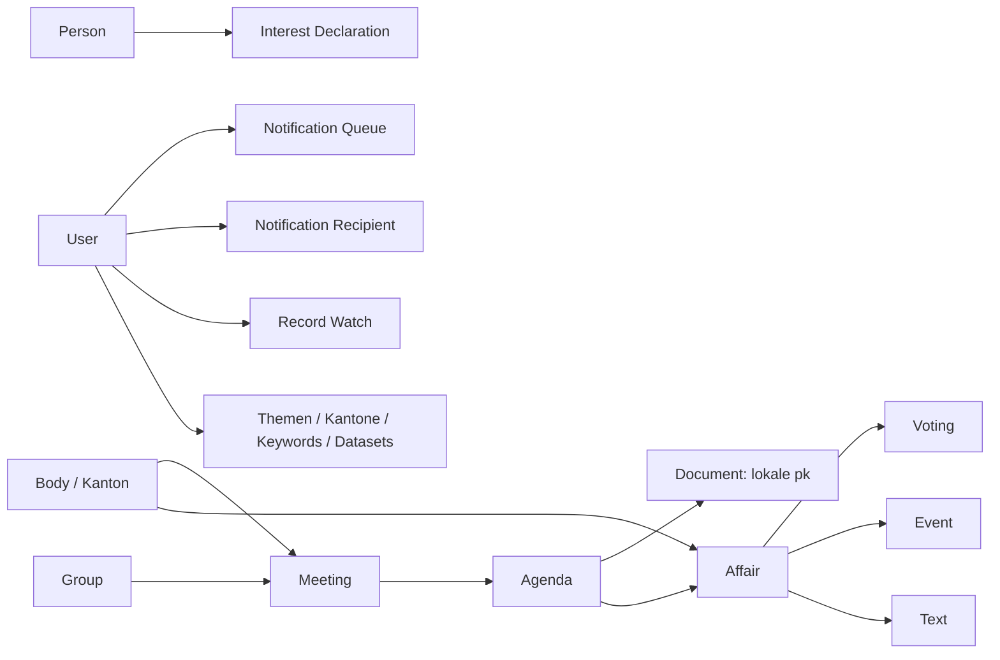

# Datenmodell

Die folgende Darstellung zeigt fachliche Beziehungen. Sie behauptet keine physisch vorhandenen Fremdschlüssel für alle importierten Quelldaten; konkrete Spalten und Constraints stehen in `app/models/` und `migrations/`.

## Parlamentarische Inhalte

Kantone werden unter anderem über Body-Zuordnungen bestimmt. Sitzungen, Traktanden und Geschäfte ermöglichen indirekte Beziehungen. Nicht jeder Eintrag besitzt alle Verknüpfungen. Interessenbindungen werden der Person zugeordnet; eine direkte Beziehung zu einem Geschäft wird nicht pauschal angenommen.

Dokumente besitzen einen lokalen Primärschlüssel `pk`. Die externe `source_id` kann wegen mehrerer Zuordnungszeilen wiederholt vorkommen. Details und Watches verwenden die lokale ID; Bestandsprüfungen unterscheiden Zeilenanzahl und eindeutige Quell-IDs.

## Klassifikation und Monitoring

Kategorien besitzen Elternbeziehungen; Regeln, Klassifikationen und Evidenz speichern die regelbasierte Auswahl. Nutzerbezogene Tabellen halten Filter, Watches und Empfänger. Change Events repräsentieren Änderungen; die Benachrichtigungswarteschlange hält die daraus ausgewählten ausstehenden Zustellungen. Sync-Checkpoints und lokale Jobdateien dienen der Wiederaufnahme.

Löschung eines Kontos betrifft dessen zugehörige Einstellungen; öffentliche parlamentarische Quelldaten sind davon getrennt. Schemaänderungen erfolgen mit Alembic. Klassifikations- oder Taxonomieänderungen können zusätzliche Backfills und Migrationen von Abonnements erfordern.
