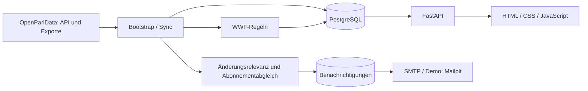

# Architektur

Die Anwendung besteht aus einer FastAPI-API mit eingebauter Weboberfläche, einer PostgreSQL-Datenbank und separat ausgeführten Import-, Klassifikations- und Sync-Prozessen. Es gibt keinen separaten Frontend-Build.

## Verantwortlichkeiten

| Pfad | Verantwortung |
|---|---|
| `app/main.py` | Anwendung, statische Dateien, Health-Check |
| `app/api/` | Routen, Eingabevalidierung und Zugriffskontrolle |
| `app/core/config.py` | Einstellungen aus Umgebung und `.env` |
| `app/db/`, `app/models/` | Datenbankzugriff und persistierte Modelle |
| `app/services/` | Recherche, Klassifikation, Abonnementabgleich und E-Mail-Dienste |
| `app/web/` | Oberfläche und Übersetzungen |
| `migrations/` | Alembic-Schemaänderungen |
| `scripts/bootstrap/` | Erstdownload und normalisierter Import |
| `scripts/sync/` | Neun Dataset-Jobs, Runner, Scheduler und Diagnosen |
| `scripts/demo/`, `data/demo/` | Isolierter Demostart und Stichprobe |
| `tests/` | Backend-, JavaScript- und Browserprüfungen |

## Daten und Beziehungen

Die öffentlichen Bereiche sind `affairs`, `agendas`, `meetings`, `votings`, `events`, `documents`, `texts`, `groups` und `interests`. Bodies, Personen und Mitgliedschaften liefern zusätzlichen Kontext. Beziehungen stammen aus den Quelldaten und können fehlen.

Ein Geschäft kann mit Traktanden, Ereignissen, Texten, Dokumenten und Abstimmungen verbunden sein. Sitzungen haben Traktanden und weitere verknüpfte Inhalte. Kantone werden unter anderem über `affairs.body_id → bodies.id → bodies.canton_key` aufgelöst.

Bei Dokumenten ist die externe `source_id` nicht eindeutig: mehrere lokale Zeilen können verschiedene Zuordnungen desselben Quelldokuments enthalten. Details und Watches verwenden deshalb den lokalen Primärschlüssel `pk`. Zeilenanzahl und Anzahl eindeutiger Quell-IDs dürfen bei Vollständigkeitsprüfungen nicht gleichgesetzt werden.

## Klassifikation und Benachrichtigungen

Mehrsprachige Regeln ordnen Inhalte hierarchischen WWF-Themen zu. Scores und Evidenz ermöglichen die Nachvollziehbarkeit. Die Taxonomie ist fachlich noch abzustimmen; die Auffangkategorie ist keine nachgewiesene hohe Klassifikationsqualität.

Der Themenbaum ist in `app/classification/taxonomy.json` konfiguriert. Lokales Sonstiges erhält eine erkannte Hauptzuordnung, globales Sonstiges dient fachfremden Inhalten. `rule-based-v7` verarbeitet Titelzusammensetzungen und verlangt bei generischen Kontextbegriffen zusätzliche Umwelt-Qualifier. Die batchweise Neuberechnung über alle neun Bereiche ist durch Entwicklungsset und gemeinsame Sync-Sperre geschützt. Ergebnisgruppen in der Suche sind eine separate Darstellungslogik: mehrere gleichnamige Geschäftsquellen desselben Tages/derselben Körperschaft behalten ihre eigenen IDs und Details.

Gespeicherte Inhaltsänderung und Benachrichtigungsrelevanz sind getrennte Entscheidungen. Relevante Änderungen werden mit aktiven Filtern oder Einzel-Watches abgeglichen und als ausstehende Benachrichtigungen gespeichert. Vor dem Versand werden Konto, Abonnements und bestätigte Empfänger erneut geprüft.

## Ausführung und Fehlergrenzen

Der Runner verarbeitet die neun Datasets nacheinander unter einem PostgreSQL-Advisory-Lock. Batches werden einzeln committed; es gibt keine Transaktion über den vollständigen Lauf. Checkpoints und lokale Jobdateien ermöglichen eine Wiederaufnahme. Bei einem fehlgeschlagenen Dataset bleibt der Benachrichtigungsversand ausstehend.

API, Scheduler und manuelle Jobs teilen sich die Datenbank. Ein dauerhaftes Deployment benötigt deshalb gemeinsame, persistente Jobdateien sowie klar zugewiesene Prozessrollen. SMTP und Datenbank-Commit bilden keine gemeinsame Transaktion; eine exakt einmalige Zustellung ist nicht garantiert.
