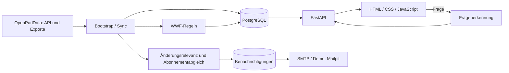

# Architektur

Die Anwendung besteht aus einer FastAPI-API mit eingebauter Weboberfläche, einer PostgreSQL-Datenbank und separat ausgeführten Import-, Klassifikations- und Sync-Prozessen. Es gibt keinen separaten Frontend-Build.

## Verantwortlichkeiten

| Pfad | Verantwortung |
|---|---|
| `app/main.py` | Anwendung, statische Dateien, Health-Check |
| `app/api/` | Routen, Eingabevalidierung und Zugriffskontrolle |
| `app/core/config.py` | Einstellungen aus Umgebung und `.env` |
| `app/db/`, `app/models/` | Datenbankzugriff und persistierte Modelle |
| `app/services/` | Recherche, Klassifikation, Abonnementabgleich (`monitoring_match_service.py`), Fragenerkennung (`query_interpreter.py`) und E-Mail-Dienste |
| `app/web/` | Oberfläche ohne Build-Schritt: `core.js` (Zustand, API-Aufrufe, Hilfsfunktionen), `search.js` (Bereiche, Filter, Ergebnisse), `detail.js` (Detailansicht), `account.js` (Anmeldung), `subscriptions.js` (Abonnements, Empfänger, Watches, Demo-Test), `ask.js` (Fragen und Antworten), `app.js` (Start), `i18n.js` (Übersetzungen) |
| `app/core/rate_limit.py`, `app/api/email_links.py` | Ratenbegrenzung sowie Bestätigungsseiten und Sitzungscookie für E-Mail-Links |
| `migrations/` | Alembic-Schemaänderungen |
| `scripts/bootstrap/` | Erstdownload und normalisierter Import |
| `scripts/sync/` | Gemeinsamer Sync-Ablauf (`entity_sync.py`), Quelle und Feldzuordnung je Bereich, Runner, Scheduler und Diagnosen |
| `scripts/demo/`, `data/demo/` | Isolierter Demostart und Stichprobe |
| `tests/` | Backend-, API-, JavaScript- und Browserprüfungen sowie Prüfset der Klassifikation |
| `.github/workflows/ci.yml` | CI: Lint, Tests, Migrationen auf PostgreSQL 17, Docker-Build |

## Daten und Beziehungen

Die öffentlichen Bereiche sind `affairs`, `agendas`, `meetings`, `votings`, `events`, `documents`, `texts`, `groups` und `interests`. Bodies, Personen und Mitgliedschaften liefern zusätzlichen Kontext. Beziehungen stammen aus den Quelldaten und können fehlen.

Ein Geschäft kann mit Traktanden, Ereignissen, Texten, Dokumenten und Abstimmungen verbunden sein. Sitzungen haben Traktanden und weitere verknüpfte Inhalte. Kantone werden unter anderem über `affairs.body_id → bodies.id → bodies.canton_key` aufgelöst.

Bei Dokumenten ist die externe `source_id` nicht eindeutig: mehrere lokale Zeilen können verschiedene Zuordnungen desselben Quelldokuments enthalten. Details und Watches verwenden deshalb den lokalen Primärschlüssel `pk`. Zeilenanzahl und Anzahl eindeutiger Quell-IDs dürfen bei Vollständigkeitsprüfungen nicht gleichgesetzt werden.

## Klassifikation und Benachrichtigungen

Mehrsprachige Regeln ordnen Inhalte hierarchischen WWF-Themen zu. Scores und Evidenz ermöglichen die Nachvollziehbarkeit. Die Taxonomie ist fachlich noch abzustimmen; die Auffangkategorie ist keine nachgewiesene hohe Klassifikationsqualität.

Der Themenbaum ist in `app/classification/taxonomy.json` konfiguriert. Lokales Sonstiges erhält eine erkannte Hauptzuordnung, globales Sonstiges dient fachfremden Inhalten. `rule-based-v8` verarbeitet Titelzusammensetzungen, verlangt bei generischen Kontextbegriffen zusätzliche Umwelt-Qualifier und kennt Ausschlussregeln für bekannte Fehltreffer. Die batchweise Neuberechnung über alle neun Bereiche ist durch Entwicklungsset und gemeinsame Sync-Sperre geschützt. Ergebnisgruppen in der Suche sind eine separate Darstellungslogik: mehrere gleichnamige Geschäftsquellen desselben Tages/derselben Körperschaft behalten ihre eigenen IDs und Details.

Gespeicherte Inhaltsänderung und Benachrichtigungsrelevanz sind getrennte Entscheidungen. Relevante Änderungen werden mit den aktiven Abonnements (bis zu zehn pro Konto, ODER-verknüpft) und Einzel-Watches abgeglichen und als ausstehende Benachrichtigungen gespeichert. Vor dem Versand werden Konto, Abonnements und bestätigte Empfänger erneut geprüft.

## Ausführung und Fehlergrenzen

Der Runner verarbeitet die neun Datasets nacheinander unter einem PostgreSQL-Advisory-Lock. Jeder Bereich liest nur Änderungen, neue und fehlende IDs; vollständige Vergleiche laufen in festen Abständen ([Synchronisierungsstrategie](../monitoring.md#synchronisierungsstrategie)). Batches werden einzeln committed; es gibt keine Transaktion über den vollständigen Lauf. Checkpoints und lokale Jobdateien ermöglichen eine Wiederaufnahme. Bei einem fehlgeschlagenen Dataset bleibt der Benachrichtigungsversand ausstehend.

API, Scheduler und manuelle Jobs teilen sich die Datenbank. Ein dauerhaftes Deployment benötigt deshalb gemeinsame, persistente Jobdateien sowie klar zugewiesene Prozessrollen. SMTP und Datenbank-Commit bilden keine gemeinsame Transaktion; eine exakt einmalige Zustellung ist nicht garantiert. Die konkrete Abbildung auf Azure beschreibt die [Azure-Integration](azure-integration.md).

## Erweiterungspunkte für KI

Klassifikation und Fragenerkennung sind regelbasiert, weil sie damit nachvollziehbar und ohne Betriebskosten für Modelle laufen und weil frühere Versuche mit lokalen Sprachmodellen (Ollama) die Genauigkeit der Regeln nicht erreichten. Beide sind so gekapselt, dass ein Sprachmodell sie ergänzen oder ersetzen kann, ohne API, Oberfläche oder Benachrichtigungen zu ändern:

| Erweiterungspunkt | Schnittstelle | Mögliche KI-Variante |
|---|---|---|
| Fragenerkennung | `QueryInterpreter.interpret(db, question, affair_types, today) -> Interpretation` in `app/services/query_interpreter.py`; Auswahl über `get_interpreter()` | Ein Sprachmodell füllt dieselbe `Interpretation` (Bereich, Thema, Kanton, Geschäftstyp, Zeitraum, Suchbegriff). Die Antwort bleibt auf echte Datensätze beschränkt; die Oberfläche zeigt weiterhin, was verstanden wurde |
| Klassifikation | `AffairClassifier.classify()` liefert Kategorien mit Score, Konfidenz und Evidenz; gespeichert mit `classifier_version` | Ein Modell schlägt Kategorien vor; Regeln und Modell lassen sich über `classifier_version` parallel speichern und vergleichen |
| Qualitätsmessung | `scripts.evaluate_holdout` mit zwei blinden Prüfsets | Jede KI-Variante wird mit denselben Prüfsets gegen die Regeln gemessen, bevor sie produktiv wird |
| Zusammenfassungen | Detail-API und Benachrichtigungsinhalte | Kurzfassungen langer Texte als zusätzliches Feld, klar als maschinell erzeugt gekennzeichnet |

Ein Chat mit frei formulierten Antworten wäre eine Retrieval-Erweiterung: Die Fragenerkennung bestimmt die Filter, die Suche liefert die Datensätze, und erst daraus formuliert ein Modell die Antwort mit Quellenangaben.
