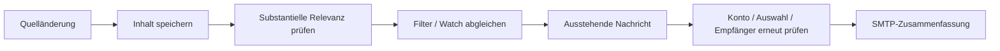

# Benachrichtigungskonzept

## Auswahl und Zusammenfassung

Datasetbezogene Regeln bewerten substantive Änderungen. Metadaten, Formatierung und begrenzte geringfügige Korrekturen bleiben typischerweise still. Numerische und bedeutungsverändernde Textänderungen können relevant sein. Die deterministische Regel ist kein Beweis tatsächlicher politischer Bedeutung.

Verfügbare Beziehungen ordnen Änderungen einem Geschäft zu. Der Versand fasst pro Nutzer und Geschäft beziehungsweise eigenständigem Inhalt zusammen. Es gibt weder eine allgemeine Grenze von 100 Nachrichten noch einen implementierten Anspruch auf genau eine tägliche E-Mail je Nutzer.

## Empfänger

Bis zu zehn Benachrichtigungsadressen werden verwaltet. Die Anmeldeadresse ist bereits bestätigt; andere Adressen erhalten einen zeitlich begrenzten Bestätigungslink. Monitoring sendet nur an bestätigte Ziele. Bestehende Konten ohne eigene Auswahl verwenden weiterhin die Anmeldeadresse.

## Fehlergrenzen

Ein vollständiger erfolgreicher Dataset-Abgleich ist Voraussetzung für den regulären Versand. Fehlgeschlagene Zustellungen bleiben ausstehend. Bei teilweise zugestellten Empfängerlisten und späteren Fehlern können Wiederholungen vorkommen. SMTP und Datenbank haben keine gemeinsame Transaktion; genau einmalige Zustellung wird nicht garantiert.

Organisationsprovider, Quoten, Absender und Links vor einem Betrieb testen. Mailpit prüft lokale Abläufe, nicht echte externe Zustellbarkeit. Historisch beobachtete SMTP-Abbrüche bleiben ein Anlass für ein eigenes Betriebsprüf-Issue.
