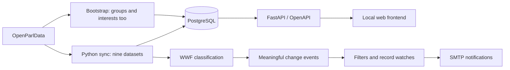

# WWF requirements review — 11 October 2026

This review compares Attila Steinegger's email with the implementation. Questions
about scope and the final taxonomy remain decisions to agree with WWF.

| Requirement | Current status |
| --- | --- |
| New records by canton and WWF topic | Implemented across nine datasets, including parent-category matching. |
| Individual keywords in subscriptions | Implemented: up to 20 literal, case-insensitive phrases. Any phrase matches; topic, keyword and canton restrictions apply together. |
| Follow a specific existing affair/meeting | Implemented; as of 12 October 2026, watches are managed in subscription management. Affair watches include related changes; meeting watches include records with that meeting ID. Watches survive changing classifications and general filters. |
| Votes | Implemented as `votings`: sync, search, classification and monitoring. |
| Groups | Implemented: frontend, filters, own/inherited classification, daily/manual sync and record monitoring. Details include related meetings. Group watches include meeting-linked changes. |
| Interest Declarations | Implemented as `interests`: frontend, filters, own classification, daily/manual sync and record monitoring. Details show the declaring person from the imported data. No direct affair association is assumed. |
| Python instead of Java/Spring | FastAPI, SQLAlchemy, Alembic and scheduler are Python; no Java service. |
| Existing Streamlit environment | Current UI is plain HTML/CSS/JavaScript served by FastAPI. Streamlit was mentioned as existing WWF technology, not a mandatory UI requirement. |
| Technical documentation/results | Setup and monitoring behavior in `monitoring.md`; automated regression tests. Live end-to-end and deployment verification remain open. |

## Provisional taxonomy

The email says the final topics will be clarified with WWF experts. Current
rules are provisional and should not be described as WWF-approved.

| Requested initial theme | Current mapping / gap |
| --- | --- |
| Erneuerbare Wärme (heizen/kühlen) | `climate_energy / renewable_heat`; cooling coverage needs expert review. |
| Erneuerbare Stromerzeugung (Wind/PV) | `climate_energy / renewable_electricity`; PV and wind concepts exist. |
| Effizienz in Gebäuden | `climate_energy / building_efficiency` |
| Elektromobilität | `climate_energy / sustainable_mobility`; also includes other sustainable transport. |
| Vorbildfunktion der öffentlichen Hand | `environment_policy / public_sector`; Vorbildfunktion concept exists, but is outside Klima & Energie. |
| Rechenzentren | Combined category `climate_energy / large_consumers_datacenters`. |
| Grossverbraucher | Same combined category; independent category subscriptions are unavailable. Keywords distinguish them provisionally. |

Agree whether to split Rechenzentren/Grossverbraucher, move the public-sector
theme under Klima & Energie, restrict mobility to electromobility and display
other main themes during the initial focus. Splitting or moving categories
requires migrating existing subscriptions and historical classifications.

## Architecture and scope

## Azure integration decisions

Docker, PostgreSQL, environment-based configuration and OpenAPI provide integration
building blocks. Compatibility with WWF's internal Azure environment has not been
validated, and no cloud infrastructure has been selected or deployed.

The same image runs the API with
`python -m uvicorn app.main:app --host 0.0.0.0 --port 8000`, the scheduler via its
default command, and migrations with `python -m alembic upgrade head`. Migration
files are included in the image. Apply migrations before starting API/worker.
Local compose currently defines PostgreSQL and the scheduler; the API runs locally.

Agree the hosting of API and scheduled worker, PostgreSQL security, secret
management for JWT/API/SMTP keys, public HTTPS URL, outbound API/email access,
organizational authentication requirements and expected synchronization duration.
Local subprocesses and JSON files are not distributed job monitoring: separate
API/worker containers need shared results storage or a replacement status store.
Container logs and database backups also need an agreed operational owner.

## Verification

60 isolated regression tests pass, with frontend translation checks and isolated
Edge browser checks. A real resumed sync completed 9/9 datasets; 77 real emails
were delivered before an SMTP authentication disconnect. Azure integration,
reliable SMTP delivery, expert taxonomy approval and final WWF use-case acceptance
remain open. See [daily review](daily-review-2026-10-11.md) for the detailed evidence.

## Public navigation and subscriptions

Public browsing offers all nine content types as separate left-navigation sections.
Keyword/theme/canton/date filters apply to the selected dataset only, and filter
selections are remembered independently for each section. Each card opens full
details and contextual links to related affairs, meetings, agendas and records.
All nine datasets remain in synchronization and the API. Subscription management groups
subtopics under main themes and provides canton, keyword and dataset filters.
Email verification returns to the application and updates an existing tab while
preserving its current view and filters.

Notification eligibility now uses explicit per-dataset substantive-change rules,
separate from source persistence. Technical/formatting changes are stored but do
not notify. Pending notifications are rechecked, and related updates are grouped
into one summary per user/affair. See the monitoring guide for the rule table.
