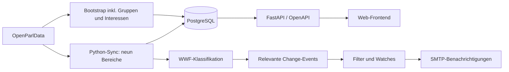

# WWF-Anforderungsprüfung

**Erstellt am 11. Oktober 2026, aktualisiert am 21. Oktober 2026.** Diese Prüfung vergleicht die von Attila Steinegger per E-Mail formulierten Anforderungen mit der Umsetzung. Fragen zu Umfang und endgültiger Taxonomie bleiben mit WWF abzustimmen.

| Anforderung | Aktueller Stand |
| --- | --- |
| Neue Datensätze nach Kanton und WWF-Thema | In neun Bereichen umgesetzt, einschliesslich Abgleich über Hauptthemen. |
| Eigene Stichwörter in Abonnements | Umgesetzt: bis zu 20 wörtliche Phrasen ohne Gross-/Kleinschreibung. Jede Phrase genügt; Themen-, Stichwort- und Kantonseinschränkung gelten gemeinsam. |
| Bestimmtes Geschäft oder bestimmte Sitzung verfolgen | Umgesetzt; seit dem 12. Oktober 2026 in der Abonnementverwaltung. Geschäfts-Watches umfassen verknüpfte Änderungen, Sitzungs-Watches Datensätze mit dieser Sitzungs-ID. Watches gelten unabhängig von Klassifikationsänderungen und allgemeinen Filtern. |
| Abstimmungen | Als `votings` umgesetzt: Synchronisation, Suche, Klassifikation und Monitoring. |
| Gruppen | Umgesetzt: Frontend, Filter, eigene und geerbte Klassifikation, tägliche/manuelle Synchronisation und Monitoring. Details enthalten verknüpfte Sitzungen; Gruppen-Watches umfassen sitzungsbezogene Änderungen. |
| Interessenbindungen | Als `interests` umgesetzt: Frontend, Filter, eigene Klassifikation, tägliche/manuelle Synchronisation und Monitoring. Details zeigen die deklarierende Person aus den importierten Daten. Eine direkte Geschäftsbeziehung wird nicht angenommen. |
| Python statt Java/Spring | FastAPI, SQLAlchemy, Alembic und Scheduler sind in Python umgesetzt; kein Java-Dienst. |
| Bestehende Streamlit-Umgebung | Die Oberfläche ist schlichtes HTML/CSS/JavaScript und wird von FastAPI ausgeliefert. Streamlit wurde als vorhandene WWF-Technologie genannt, nicht als zwingende Vorgabe für die Oberfläche. |
| Technische Dokumentation und Ergebnisse | Einrichtung, Monitoring, Tests und Betrieb sind dokumentiert; automatisierte Regressionstests und CI. Live-End-to-End- und Bereitstellungsprüfung in der WWF-Umgebung bleiben offen. |

## Vorläufige Taxonomie

Laut E-Mail werden die endgültigen Themen mit WWF-Fachpersonen geklärt. Die aktuellen Regeln sind vorläufig und dürfen nicht als von WWF freigegeben bezeichnet werden.

| Gewünschtes Startthema | Aktuelle Zuordnung / Lücke |
| --- | --- |
| Erneuerbare Wärme (heizen/kühlen) | `climate_energy / renewable_heat`; die Abdeckung von Kühlung braucht eine fachliche Prüfung. |
| Erneuerbare Stromerzeugung (Wind/PV) | `climate_energy / renewable_electricity`; Konzepte für PV und Wind vorhanden. |
| Effizienz in Gebäuden | `climate_energy / building_efficiency` |
| Elektromobilität | `climate_energy / sustainable_mobility`; umfasst auch weiteren nachhaltigen Verkehr. |
| Vorbildfunktion der öffentlichen Hand | `environment_policy / public_sector`; allgemeine Begriffe zur öffentlichen Hand benötigen einen Umweltbezug und bleiben ausserhalb von Klima & Energie. |
| Rechenzentren | Gemeinsame Kategorie `climate_energy / large_consumers_datacenters`. |
| Grossverbraucher | Dieselbe gemeinsame Kategorie; getrennte Abonnements sind nicht möglich. Stichwörter unterscheiden vorläufig. |

Abzustimmen ist, ob Rechenzentren und Grossverbraucher getrennt werden, ob die Vorbildfunktion unter Klima & Energie gehört, ob Mobilität auf Elektromobilität beschränkt wird und ob weitere Hauptthemen während des Startfokus angezeigt werden. Das Aufteilen oder Verschieben von Kategorien erfordert eine Migration bestehender Abonnements und historischer Klassifikationen.

## Architektur und Umfang

Seit dem 13. Oktober werden Kategorien und Regeln in `app/classification/taxonomy.json` gepflegt, mit einer lokalen Kategorie «Sonstiges» je Hauptthema und einem separaten globalen Fallback. Etiketten zeigen Haupt-/Unterthema. Die Regelversion `rule-based-v7` deckt alle 2'951'254 lokalen Quelldatensätze ab.

Qualität: Auf dem 50-Beispiele-Entwicklungsset, an dem die Regeln verbessert wurden, erreicht v7 50/50. Auf einem am 21. Oktober gezogenen, blind annotierten Prüfset von 300 zufälligen Geschäften erkennt v7 WWF-relevante Geschäfte mit Precision 1.0 und Recall 0.325 (13 von 40). Die Regeln sind also sehr präzise, übersehen aber die Mehrheit relevanter Geschäfte. Details: [Prüfset-Auswertung](05-testing/evidence/holdout-evaluation.md). Eine Bewertung durch WWF-Fachpersonen steht weiterhin aus.

## Azure-Integration

Docker, PostgreSQL, Konfiguration über Umgebungsvariablen und OpenAPI sind Bausteine für eine Integration. Die Kompatibilität mit der internen Azure-Umgebung von WWF wurde nicht geprüft; es wurde keine Cloud-Infrastruktur gewählt oder bereitgestellt.

`docker-compose.yml` startet PostgreSQL (nur lokal erreichbar), einen einmaligen Migrationsdienst, die API und den Scheduler aus demselben Image. Abzustimmen sind Hosting von API und Worker, PostgreSQL-Sicherheit, Secret-Management für JWT-, API- und SMTP-Schlüssel, eine öffentliche HTTPS-URL, ausgehender API- und E-Mail-Zugriff, organisatorische Authentifizierung und die erwartete Synchronisationsdauer. Lokale Subprozesse und JSON-Dateien sind kein verteiltes Job-Monitoring: Getrennte API- und Worker-Container benötigen einen gemeinsamen Ergebnisspeicher oder einen anderen Statusspeicher. Die Ratenbegrenzung arbeitet pro API-Prozess; mehrere Instanzen benötigen einen gemeinsamen Speicher. Container-Logs und Datenbanksicherungen brauchen eine vereinbarte Betriebsverantwortung.

## Prüfung

Stand 21. Oktober 2026: 124 isolierte Backend-, API- und Klassifikationstests sowie die Frontend-Prüfungen sind erfolgreich; die CI prüft zusätzlich Lint, Migrationen auf PostgreSQL 17 und den Docker-Build. Ein Edge-Durchlauf in einer isolierten Demo-Umgebung bestätigte Recherche, Registrierung über Mailpit, Bestätigungsseite, Demo-Benachrichtigung und Abmeldung. Azure-Integration, zuverlässiger Organisationsversand, fachliche Taxonomiefreigabe und die Abnahme der WWF-Anwendungsfälle bleiben offen. Historische Nachweise: [Review vom 11. Oktober](daily-review-2026-10-11.md).

## Öffentliche Navigation und Abonnements

Die öffentliche Recherche bietet alle neun Inhaltstypen als eigene Bereiche in der linken Navigation. Stichwort-, Themen-, Kantons- und Datumsfilter gelten für den gewählten Bereich und werden pro Bereich gemerkt. Jede Karte öffnet Details und Links zu verknüpften Geschäften, Sitzungen, Traktanden und Datensätzen. Die Abonnementverwaltung gruppiert Unterthemen unter Hauptthemen und bietet Kantons-, Stichwort- und Bereichsfilter. Nach der E-Mail-Bestätigung kehrt die Anwendung zurück und aktualisiert einen offenen Tab, ohne dessen Ansicht und Filter zu verlieren.

Die Benachrichtigungsrelevanz folgt ausdrücklichen Regeln pro Bereich und ist von der Speicherung der Quelldaten getrennt. Technische und reine Formatierungsänderungen werden gespeichert, lösen aber keine E-Mail aus. Ausstehende Benachrichtigungen werden erneut geprüft, und verknüpfte Änderungen werden pro Nutzer und Geschäft zusammengefasst. Die Regeltabelle steht in der [Monitoring-Dokumentation](monitoring.md).
